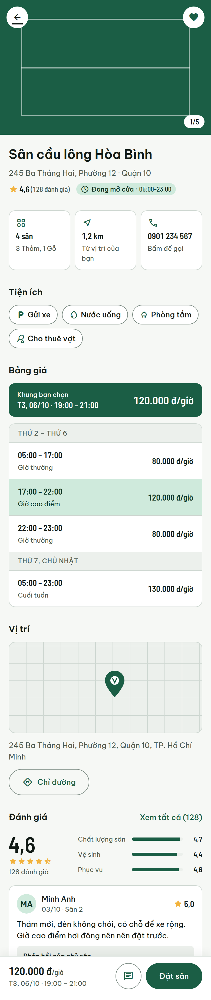
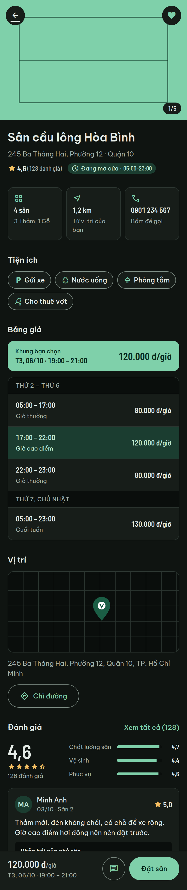

# Nhóm 3 — Chi tiết sân

| Thuộc tính | Giá trị |
|---|---|
| Mã nhóm | `03` |
| Vai trò sử dụng | Người chơi |
| Thành viên phụ trách | A |
| App tham khảo | Alobo |
| Trạng thái | 🟨 Đang làm (US1–US6 đã cài, còn kiểm thử thủ công) |
| Nhánh Git | `feature/03-court-detail-impl` (US1–US4, PR #51), `feature/030-court-detail-us5-us6` (US5, US6, Polish) |
| Spec (Spec Kit) | [spec](../../../specs/030-court-detail/spec.md) · [plan](../../../specs/030-court-detail/plan.md) · [tasks](../../../specs/030-court-detail/tasks.md) · [quickstart](../../../specs/030-court-detail/quickstart.md) |

## Phạm vi chức năng

Lấy từ [Proposal](../../proposal/Proposal.html), mục 5.

- [x] Thư viện ảnh (vuốt, chỉ báo "1/5", xem ảnh toàn màn hình có phóng to)
- [x] Bảng giá theo khung giờ (giờ thường, giờ cao điểm, cuối tuần) và giá của khung giờ đã chọn từ tìm kiếm
- [x] Tiện ích, số lượng sân, loại mặt sân
- [x] Giờ mở cửa, thông tin liên hệ (bấm để gọi, nhấn giữ để sao chép)
- [x] Vị trí trên bản đồ nhúng (marker quả cầu lông) và chỉ đường (mở Google Maps)
- [x] Đánh giá tổng quan và 3 đánh giá mới nhất
- [x] Khách xem được mọi thông tin; bấm "Đặt sân", trái tim, chat thì được mời đăng nhập, đăng nhập xong thao tác tự chạy tiếp
- [x] Lưu sân yêu thích (gọi `FavoriteRepository` của 070)
- [x] Cơ sở tạm ngừng hoạt động hoặc không còn tồn tại
- [ ] Chat với chủ sân: chờ deep link `smashnow://chat/direct` của 091, hiện tại báo "Tính năng sắp có"

## Ảnh chụp tham khảo

Wireframe: [`specs/030-court-detail/ui/`](../../../specs/030-court-detail/ui/README.md).

| Wireframe | Ảnh |
|---|---|
| Chế độ sáng |  |
| Chế độ tối |  |

Ảnh chụp app lưu ở [`screenshots/`](screenshots/), đặt tên theo dạng `03_court-detail_buocX_mo-ta.png` (T072, đang chờ chụp).

| Bước | Ảnh | Mô tả |
|---|---|---|
| Q1 | _chờ chụp_ | Chi tiết sân đầy đủ các mục |
| Q11 | _chờ chụp_ | Mục đánh giá với 3 đánh giá mới nhất |
| Q13 | _chờ chụp_ | Khách bấm "Đặt sân", hộp mời đăng nhập |
| Q17 | _chờ chụp_ | Cơ sở tạm ngừng hoạt động |

Dữ liệu demo lấy từ datlich.alobo.vn, chỉ dùng cho mục đích học tập (quyết định C1, [research R13](../../../specs/030-court-detail/research.md#r13-dữ-liệu-seed-của-nhóm-scriptsseed-và-constitution-vi)).

## Ghi chú thiết kế / quyết định

- **Bản đồ dùng osmdroid (OpenStreetMap)** thay vì Google Maps SDK vì nhóm dùng Firebase Spark, không có tài khoản thanh toán. Bản đồ chỉ khởi tạo khi mục "Vị trí" sắp hiện ([research R7](../../../specs/030-court-detail/research.md)).
- **Dữ liệu seed** ở `scripts/seed/` chỉ dùng cho demo, ghi rõ nguồn (R13).
- **Thao tác đang chờ của khách** lưu trong `SavedStateHandle`, nên giữ được khi xoay màn hình và khi app bị hệ thống đóng. `PendingActionResolver` quyết định chạy, hủy hay chờ (R11).
- **Yêu thích** đi qua `FavoriteGateway` của 030, bản thật gọi `FavoriteRepository` của 070. Trái tim đổi ngay, ghi lỗi thì trả lại trạng thái cũ.
- **Rules `venues` hiện tại** chỉ cho người chơi đọc cơ sở `ACTIVE`. Người đã đăng nhập mở cơ sở `HIDDEN`/`LOCKED` vì vậy thấy lỗi chung chứ không thấy ghi chú "Sân tạm ngừng hoạt động" như R10 đề xuất; đã gửi đề xuất sửa cho D (T074).
- **Máy tính bảng** (`layout-w600dp`): hai cột 40/60, cùng nằm trong một `NestedScrollView`.

## Kiểm thử và minh chứng (Definition of Done)

- [x] Có đủ các chức năng nhỏ ở trên và xử lý lỗi cơ bản (mỗi mục có trạng thái tải, rỗng, lỗi kèm "Thử lại")
- [x] Giao diện đúng thiết kế, hiển thị tốt trên ít nhất 2 kích thước màn hình (điện thoại, `w600dp`)
- [ ] Đã được review và merge vào `develop`
- [ ] Có kịch bản kiểm thử và ảnh/video minh chứng (quickstart Q1–Q24 đang chờ chạy, T071, T072)
- [x] Có log AI (nếu dùng AI) trong [`docs/ai-log/`](../../ai-log/)
