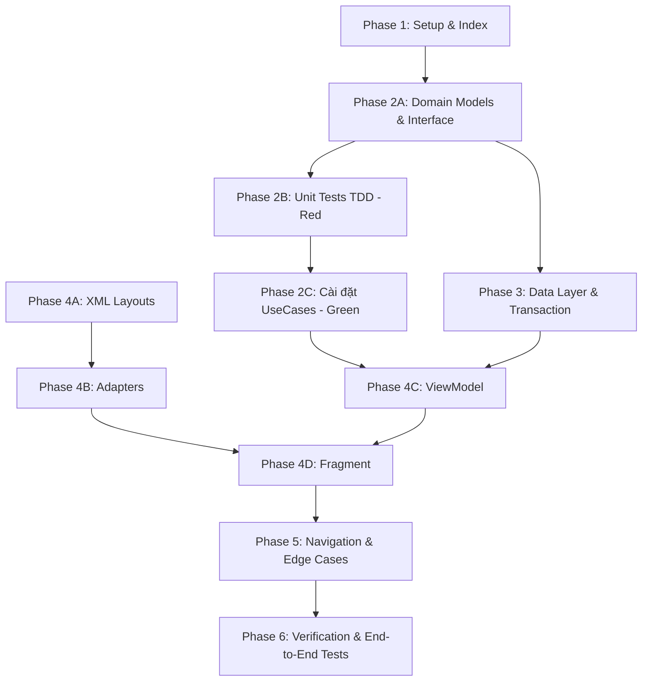

# Tasks: Lưới khung giờ đặt sân và giữ chỗ (Spec 040)

**Input**: Tài liệu thiết kế trong `specs/040-booking-slot-grid/`: [plan.md](plan.md), [spec.md](spec.md), [research.md](research.md), [data-model.md](data-model.md), [contracts/ui-contracts.md](contracts/ui-contracts.md), [quickstart.md](quickstart.md).

**Tests & Architecture Guidelines**:
- **Constitution I (Clean Architecture)**: Tầng `domain` hoàn toàn thuần Kotlin, tuyệt đối không import Android SDK (`Context`, `View`, `Bundle`) hay Firebase SDK (`Timestamp`, `DocumentSnapshot`). UseCases độc lập, có thể unit test 100% bằng JUnit4 + MockK + Turbine.
- **Constitution II & III (Money & Atomic Transaction)**: Mọi số tiền (`pricePerHour`, `subtotalAmount`, `depositAmount`) bắt buộc dùng kiểu `Long` (VND, cấm âm, cấm `Double`/`Float`). Giao dịch Firestore Transaction giữ chỗ 5 phút tuân thủ nghiêm ngặt nguyên tắc **All Reads Before All Writes** và **All-or-Nothing** (chống double-booking).
- **Thống nhất ca 30 phút & 6 trạng thái slot**: Mỗi slot biểu diễn 30 phút (`HHmm`). Người chơi có thể chọn từ 2 đến 8 slot (tối đa 4 giờ trên nhiều sân con). Hiển thị trực quan 6 trạng thái: `AVAILABLE`, `SELECTED`, `HELD`, `BOOKED`, `BLOCKED` (kèm tag `DROP_IN` theo Phương án 4.A), và `PAST` (Q1, Q2, Q7).
- **Quy trình Test-First (TDD)**: Viết Unit Test cho UseCase trước ở Phase 2, chạy thấy fail, sau đó cài đặt logic để test chuyển sang màu xanh.

---

## Quy ước viết tắt đường dẫn

| Viết tắt | Đường dẫn thực tế |
|---|---|
| `APP/` | `app/src/main/java/com/example/booking_app/` |
| `CORE/` | `app/src/main/java/com/example/booking_app/core/` |
| `BOOKING/` | `app/src/main/java/com/example/booking_app/feature/booking/` |
| `RES/` | `app/src/main/res/` |
| `TEST/` | `app/src/test/java/com/example/booking_app/` |
| `ATEST/` | `app/src/androidTest/java/com/example/booking_app/` |

---

## Danh sách công việc theo User Stories & Phases

```
US1: Xem lưới khung giờ và chọn slot đặt sân (P1)
US2: Giữ chỗ tạm thời 5 phút với nguyên tắc "Tất cả hoặc không" (P1)
US3: Xử lý hết hạn giữ chỗ và hủy giữ chỗ (P2)
US4: Yêu cầu đăng nhập và phục hồi lựa chọn (P2)
US5: Chống tạo đơn trùng lặp và xử lý mất kết nối (P3)
```

---

## Phase 1: Setup & Data Infrastructure (Nền tảng dự án)

**Mục tiêu**: Chuẩn bị cấu hình dự án, fixtures dữ liệu giả lập và kiểm tra index Firestore phục vụ truy vấn lưới slot.

- [x] T001 Kiểm tra và xác nhận các thư viện cần thiết trong `app/build.gradle.kts`: Navigation Component Safe Args, Hilt DI, Coroutines/Flow, Material 3, ViewBinding, Firebase Firestore, Turbine, MockK.
- [x] T002 [P] Khai báo Composite Index cho collection `slots` trong `firestore.indexes.json`: Fields `venueId` (ASC), `date` (ASC), `startTime` (ASC) để tối ưu query Sparse Storage theo ngày của cơ sở.
- [x] T003 [P] Tạo bộ test fixtures `TEST/feature/booking/fixture/BookingSlotFixtures.kt`: Cung cấp dữ liệu mẫu cho `CourtDto`, `PriceRuleDto`, `SlotDto`, bảng giá giờ thường (80k/h) và giờ cao điểm (150k/h) để tái sử dụng xuyên suốt bộ Unit Test.

**Checkpoint**: Chạy `./gradlew assembleDebug` thành công, index Firestore hợp lệ.

---

## Phase 2: Domain Layer & Core Business Logic (Kiến trúc thuần Kotlin & TDD)

**Mục tiêu**: Xây dựng toàn bộ Entities, Repository Interfaces và UseCases thuần Kotlin tại tầng Domain. Viết Unit Tests trước theo quy chuẩn TDD.

### 2A. Domain Models & Repository Interface
- [x] T004 [P] Định nghĩa các Domain Models trong `BOOKING/domain/model/`:
  - `Court.kt` (`id`, `name`, `surfaceType`, `isActive`, `sortOrder`)
  - `PriceRule.kt` (`id`, `daysOfWeek: List<Int>`, `startTime`, `endTime`, `pricePerHour: Long`, `label`)
  - `TimeSlot.kt` (`slotId`, `courtId`, `date`, `startTime`, `endTime`, `price: Long`, `status: SlotStatus`, `blockReason: String?`, `holdExpiresAtMillis: Long?`)
  - `SlotStatus.kt` (`AVAILABLE`, `SELECTED`, `BOOKED`, `HELD`, `BLOCKED`, `PAST`)
  - `SlotSelectionState.kt` (`selectedSlots: List<TimeSlot>`, `totalPrice: Long`, `depositAmount: Long`, `isValid: Boolean`, `errorMessage: String?`)
  - `HoldResult.kt` (`Success(bookingId, holdExpiresAtMillis)`, `Conflict(conflictedSlotIds: List<String>)`)
- [x] T005 [P] Định nghĩa Interface `BOOKING/domain/repository/BookingRepository.kt`:
  - `suspend fun getVenueOperatingHours(venueId: String): Result<Pair<String, String>>`
  - `suspend fun getActiveCourts(venueId: String): Result<List<Court>>`
  - `suspend fun getPriceRules(venueId: String): Result<List<PriceRule>>`
  - `fun getBusySlotsRealtime(venueId: String, date: String): Flow<List<TimeSlot>>`
  - `suspend fun holdSlotsAtomic(venueId: String, courtId: String, date: String, slotIds: List<String>, userId: String, requestId: String): Result<HoldResult>`
  - `suspend fun releaseHoldSlots(venueId: String, slotIds: List<String>, userId: String): Result<Unit>`

### 2B. Unit Tests (Viết trước, phải FAIL)
- [x] T006 [P] [US1] Viết Unit Test `TEST/feature/booking/domain/ValidateSlotSelectionUseCaseTest.kt`:
  - Chọn 1 slot `AVAILABLE` đầu tiên $\rightarrow$ hợp lệ, chuyển sang `SELECTED`.
  - Chọn slot tiếp theo liền kề trước/sau $\rightarrow$ nối dài chuỗi chọn thành công.
  - Chọn slot cách quãng (không liền kề) $\rightarrow$ tự động hủy chuỗi cũ trên cùng sân, chọn slot mới làm mốc bắt đầu, báo lỗi chọn liên tiếp (Q9).
  - Bỏ chọn slot ở đầu hoặc đuôi chuỗi $\rightarrow$ chỉ bỏ slot đó, giữ các slot còn lại liên tục.
  - Bỏ chọn slot ở giữa chuỗi $\rightarrow$ tự động cắt bỏ từ slot đó về cuối dãy.
  - Chặn chọn slot có trạng thái `BOOKED`, `HELD`, `BLOCKED`, hoặc `PAST`.
  - Chặn chọn vượt quá 8 slots 30 phút (= 4 giờ chơi theo FR-026 của Spec 040, tính tổng trên mọi sân).
  - Kiểm tra điều kiện tối thiểu 2 slot (1 giờ) khi bấm giữ chỗ (Q2/M2).
  - Kiểm tra chọn đa sân: mỗi sân một chuỗi liên tục độc lập, thao tác trên một sân không làm ảnh hưởng chuỗi các sân khác (Q1/M1).
- [x] T007 [P] [US1] Viết Unit Test `TEST/feature/booking/domain/CalculateTotalPriceUseCaseTest.kt`:
  - Đơn giá mỗi slot 30 phút = `pricePerHour / 2`.
  - Tính đúng tổng tiền khi toàn bộ slot nằm trong khung giờ thường (80.000đ/h $\rightarrow$ 40.000đ/slot).
  - Tính đúng tổng tiền khi toàn bộ slot nằm trong khung giờ cao điểm (150.000đ/h $\rightarrow$ 75.000đ/slot).
  - Tính đúng tổng tiền khi dãy slot vắt qua thời điểm giao thoa giữa 2 khung giá (VD: 16:30–17:30 với mốc cao điểm từ 17:00).
  - Tính cọc 30% làm tròn an toàn theo công thức `((rawDeposit + 500) / 1000) * 1000` (VND, dùng kiểu `Long`, không dùng `Double`).
- [x] T008 [P] [US1] Viết Unit Test `TEST/feature/booking/domain/GenerateDailySlotsUseCaseTest.kt`:
  - Sinh đủ các slot 30 phút từ `openTime` đến `closeTime` (ví dụ: `0600` đến `2200` sinh đúng 32 slots).
  - Gộp các slot bận từ Firestore vào lưới (các slot không có trong Firestore mặc định là `AVAILABLE`).
  - Gắn nhãn `PAST` cho các slot có thời gian bắt đầu nhỏ hơn hoặc bằng thời gian hiện tại nếu chọn ngày hôm nay.
  - Gắn nhãn `BLOCKED` kèm lý do `DROP_IN` cho các ca giao lưu mở ở Spec 080.
- [x] T009 [P] [US2] Viết Unit Test `TEST/feature/booking/domain/HoldSlotsTransactionUseCaseTest.kt`:
  - Toàn bộ slot hợp lệ $\rightarrow$ Trả về `HoldResult.Success` kèm mốc hết hạn 5 phút.
  - 1 trong các slot bị trùng lịch/đã có người giữ $\rightarrow$ Trả về `HoldResult.Conflict` chỉ rõ slot bị mất, không giữ bất kỳ slot nào (All-or-Nothing).
  - Đảm bảo tính Idempotent với cùng `requestId`: không tạo nhiều phiên giữ chỗ trùng lặp.
- [x] T010 [P] [US3] Viết Unit Test `TEST/feature/booking/domain/ReleaseHoldUseCaseTest.kt`:
  - Hủy giữ chỗ thành công $\rightarrow$ slot được nhả về trạng thái `AVAILABLE`.

### 2C. Cài đặt UseCases (Làm cho Unit Tests chuyển sang XANH)
- [x] T011 Cài đặt `BOOKING/domain/usecase/ValidateSlotSelectionUseCase.kt`. Chạy T006 chuyển sang xanh.
- [x] T012 Cài đặt `BOOKING/domain/usecase/CalculateTotalPriceUseCase.kt`. Chạy T007 chuyển sang xanh.
- [x] T013 Cài đặt `BOOKING/domain/usecase/GenerateDailySlotsUseCase.kt`. Chạy T008 chuyển sang xanh.
- [x] T014 Cài đặt `BOOKING/domain/usecase/HoldSlotsTransactionUseCase.kt`. Chạy T009 chuyển sang xanh.
- [x] T015 Cài đặt `BOOKING/domain/usecase/ReleaseHoldUseCase.kt`. Chạy T010 chuyển sang xanh.

**Checkpoint**: Toàn bộ Unit Test tầng Domain trong package `com.example.booking_app.feature.booking.domain` pass 100%.

---

## Phase 3: Data Layer & Infrastructure (Thực thi Repository & Firestore Transaction)

**Mục tiêu**: Xây dựng DTOs, Mappers, Remote Data Source và Firestore Transaction giữ chỗ nguyên tử.

- [x] T016 [P] Tạo các Data Transfer Objects trong `BOOKING/data/model/`:
  - `CourtDto.kt` (`@DocumentId id`, `name`, `surfaceType`, `isActive`, `sortOrder`)
  - `PriceRuleDto.kt` (`@DocumentId id`, `daysOfWeek`, `startTime`, `endTime`, `pricePerHour: Long`, `label`)
  - `SlotDto.kt` (`@DocumentId id`, `venueId`, `courtId`, `date`, `startTime`, `endTime`, `status`, `blockReason`, `holdExpiresAt: Timestamp?`, `holdBy: String?`, `bookingId: String?`)
  - `HoldBookingRequestDto.kt` (`venueId`, `courtId`, `date`, `slotIds: List<String>`, `userId`, `requestId`)
- [x] T017 [P] Cài đặt Mapper `BOOKING/data/mapper/BookingSlotMapper.kt`: Chuyển đổi hai chiều giữa DTOs và Domain Entities, xử lý an toàn giá trị `null` và định dạng `HHmm`.
- [x] T018 Cài đặt DataSource `BOOKING/data/datasource/BookingRemoteDataSource.kt` & `FirestoreBookingRemoteDataSource.kt`:
  - Đọc thông tin cơ sở `venues/{venueId}`, subcollection `courts` và `priceRules`.
  - Lắng nghe realtime `slots` theo `venueId` và `date` thông qua `callbackFlow`. Tự động gọi `remove()` trong `awaitClose` để giải phóng listener, tối ưu Quota Spark.
- [x] T019 Cài đặt Firestore Transaction giữ chỗ nguyên tử trong `FirestoreBookingRemoteDataSource.kt`:
  - **Pha 1 (ALL READS)**: Đọc toàn bộ các document `slots/{courtId}_{yyyyMMdd}_{HHmm}` trong danh sách yêu cầu. Kiểm tra xem có slot nào đã tồn tại và đang ở trạng thái `BOOKED`, `BLOCKED`, hoặc `HELD` (chưa hết hạn) hay không.
  - **Pha 2 (ALL WRITES)**: Nếu có bất kỳ slot nào bị trùng $\rightarrow$ rollback và trả về `HoldResult.Conflict`. Nếu tất cả đều trống $\rightarrow$ ghi đồng loạt các document slot với `status = "HELD"`, `holdExpiresAt = serverNow + 5 phút`, `holdBy = userId`.
- [x] T020 Cài đặt `BOOKING/data/repository/BookingRepositoryImpl.kt`: Triển khai đầy đủ interface `BookingRepository` từ tầng domain, bọc kết quả bằng `Result<T>` và bắt lỗi mạng chuyển đổi thành `AppError`.
- [x] T021 [P] Tạo DI Module `BOOKING/di/BookingModule.kt`: Sử dụng `@Module` và `@InstallIn(SingletonComponent::class)` để bind `BookingRepositoryImpl` và inject các UseCases.
- [x] T022 [P] Khai báo và kiểm tra Security Rules trong `firestore.rules`:
  - Cho phép người dùng đọc thông tin `slots`.
  - Chỉ cho phép tạo/cập nhật trạng thái `HELD` khi người dùng đã đăng nhập (`request.auth != null`), slot chưa có người giữ hoặc đã hết hạn giữ chỗ (`resource.data.holdExpiresAt < request.time`), và `request.resource.data.holdExpiresAt <= request.time + duration.value(5, 'm')`.

**Checkpoint**: Tích hợp Data Layer hoàn tất, Dependency Injection sẵn sàng cho UI.

---

## Phase 4: UI Layer & ViewModels (Hiển thị Lưới Slot & Tương tác)

**Mục tiêu**: Xây dựng toàn bộ giao diện XML Material 3, RecyclerView Adapters, StateFlow ViewModel, và xử lý luồng sự kiện UI.

### 4A. Layout XML & Resources
- [x] T023 [P] [US1] Tạo `RES/layout/item_date_selector.xml`: Thẻ chọn ngày ngang gồm Thứ (T2, T3...), Ngày trong tháng (15, 16...), chấm tròn highlight ngày hôm nay và hiệu ứng đổi màu khi được chọn.
- [x] T024 [P] [US1] Tạo `RES/layout/item_court_tab.xml`: Chip chọn sân con (Sân 1, Sân 2...) hiển thị tên sân và loại mặt sân (`Gỗ`, `Thảm`, `PU`).
- [x] T025 [P] [US1] Tạo `RES/layout/item_slot_grid.xml`: Ô hiển thị ca 30 phút trong ma trận:
  - Chỉ hiển thị giờ bắt đầu (vd: `17:00`), không giá, không khoảng giờ (Q7).
  - Màu sắc trạng thái theo Mockup: Trống (`AVAILABLE` - nền trắng viền xám), Đang chọn (`SELECTED` - xanh đậm `#1B5E45` kèm `✓`), Đang giữ (`HELD` - vàng nhạt icon đồng hồ), Đã đặt (`BOOKED` - xám nhạt gạch ngang), Bị khóa (`BLOCKED` - sọc chéo icon khóa, kèm tag "Giao lưu" khi `DROP_IN`), Đã qua (`PAST` - mờ alpha ~0.35) (Q7).
- [x] T026 [P] [US1] Tạo `RES/layout/view_booking_bottom_summary.xml`: Thanh tóm tắt đáy màn hình:
  - Tóm tắt tổng tiền lớn và dòng chi tiết theo từng sân (`Sân 1 · T3, 06/10 · 19:00 – 21:00 · 2 giờ`).
  - Nút "Giữ chỗ" (`MaterialButton`) tích hợp trạng thái loading/disabled khi dưới 2 slot (Q2, Q6).
- [x] T027 [P] [US1] Tạo `RES/layout/fragment_booking_slot_grid.xml`: Kết hợp tiêu đề/quận từ dữ liệu thật (Q12), dải ngày 30 mốc, pill "Đặt cố định theo tuần" (Q13), banner giờ cao điểm từ priceRules (Q5), lưới ma trận 2 chiều (cột = sân con cuộn ngang, hàng = ca 30 phút cuộn dọc; bỏ tab sân theo Q3/M3), bảng legend 6 mục (Q7), trạng thái rỗng khi sân đóng cửa và thanh tóm tắt đáy.
- [x] T028 [P] [US1] Bổ sung chuỗi văn bản trong `RES/values/strings_booking.xml` và bảng màu Material token trong `RES/values/colors_booking.xml`.

### 4B. Adapters & Custom UI
- [x] T029 [P] [US1] Cài đặt `BOOKING/ui/adapter/DateSelectorAdapter.kt`: Sử dụng `ListAdapter` + `DiffUtil`, hiển thị danh sách 30 ngày từ hôm nay (Asia/Ho_Chi_Minh), thẻ "Hôm nay", "Mai", T2-CN kèm chấm hôm nay (Q7).
- [x] T030 [P] [US1] Bỏ `CourtTabAdapter.kt` theo Q3/M3 (thay bằng cấu trúc cột sân con trong ma trận 2 chiều).
- [x] T031 [P] [US1] Cài đặt `BOOKING/ui/adapter/SlotMatrixRowAdapter.kt`: Adapter cho từng hàng giờ trong ma trận, hiển thị các ô slot tương ứng với từng sân con; click vào ô nào cũng phản hồi qua ViewModel (kể cả ô không trống hiện Snackbar thông báo) (Q3, Q7, Q9).

### 4C. ViewModel & State Machine
- [x] T032 [P] [US1, US2] Định nghĩa `BookingSlotUiState.kt` và `BookingSlotUiEffect.kt` trong `BOOKING/ui/`:
  - `BookingSlotUiState`: `isLoading`, `venueId`, `venueName`, `venueAddress`, `districtName`, `operatingHours`, `courts: List<Court>`, `dates: List<LocalDate>`, `selectedDate`, `matrixSlots: Map<String, List<TimeSlot>>`, `selectedSlots: List<TimeSlot>`, `totalAmount: Long`, `depositAmount: Long`, `canProceed: Boolean`, `isHolding: Boolean`, `peakHourBannerText: String?`, `errorMessage: String?` (bỏ selectedCourtId đơn, hỗ trợ đa sân theo Q1, Q12).
  - `BookingSlotUiEffect`: `ShowConflictWarning(message)`, `NavigateToBookingSummary(args)` (giữ tên điều hướng sang màn hình xác nhận [040] theo Q4), `NavigateToLogin`, `ShowToast(message)`, `ShowErrorSnackbar(message)`.
- [x] T033 [US1, US2, US3, US4, US5] Cài đặt `BOOKING/ui/BookingSlotGridViewModel.kt`:
  - Khởi tạo nhận `venueId` bắt buộc (không fallback ngầm demo-venue-01 theo Q12).
  - Tải thông tin cơ sở thật (`getVenueInfo`), danh sách sân con và bảng giá.
  - Lắng nghe realtime các slot bận của cơ sở và sinh lưới ma trận đa sân.
  - Xử lý chọn đa sân (chuỗi riêng mỗi sân, tổng tối đa 8 slot, min 2 slot để tiếp tục) (Q1, Q2, Q9).
  - Giữ chỗ 5 phút đa sân All-or-Nothing trong 1 transaction; khi conflict chỉ loại slot mất và giữ slot còn trống (Q8).
  - Lưu và khôi phục lựa chọn khi chuyển sang đăng nhập (Q10).

### 4D. Fragment & User Interactions
- [x] T034 [US1, US2, US3, US4] Cài đặt `BOOKING/ui/BookingSlotGridFragment.kt` và `BookingConfirmFragment.kt`:
  - `BookingSlotGridFragment`: Khởi tạo lưới ma trận, hiển thị banner cao điểm, nút "Đặt cố định theo tuần" (Q13), dialog cảnh báo đổi ngày (US1-AS8; bỏ dialog đổi sân theo Q3).
  - `BookingConfirmFragment`: Màn hình xác nhận giữ chỗ 5 phút của spec 040 (Q4/FR-018) hiển thị tên + địa chỉ thật, chi tiết từng sân, tổng tiền, đếm ngược từ 05:00 theo `holdExpiresAt` thật, nút "Hủy/Quay lại" nhả slot ngay và nút "Thanh toán" chuyển tiếp sang 050.

**Checkpoint**: Giao diện ma trận hiển thị mượt mà, chọn đa sân chuẩn xác, màn hình xác nhận đếm ngược hoạt động đúng yêu cầu.

---

## Phase 5: Navigation, Integration & Edge Cases (Xử lý Ngoại lệ & Liên module)

**Mục tiêu**: Xử lý triệt để các trường hợp biên, kết nối điều hướng sang Spec 050 và khôi phục lựa chọn sau đăng nhập từ Spec 010.

- [x] T035 [P] [US2] Cấu hình Navigation Safe Args trong `RES/navigation/nav_player.xml`:
  - Action từ `CourtDetailFragment` (Spec 030) sang `BookingSlotGridFragment` nhận `venueId: String`.
  - Action từ `BookingSlotGridFragment` sang `BookingConfirmFragment` (Spec 040) truyền `HoldToPaymentArgs` (Q4).
  - Action từ `BookingConfirmFragment` sang `PaymentFragment` (Spec 050) truyền `HoldToPaymentArgs` khi người dùng bấm "Thanh toán".
- [x] T036 [US4] Tích hợp với Auth Flow (Spec 010):
  - Khi khách vãng lai bấm "Giữ chỗ", ViewModel phát hiện chưa đăng nhập $\rightarrow$ lưu tạm danh sách slot vào SavedStateHandle và điều hướng sang Login.
  - Khi đăng nhập thành công và quay lại, tự động kiểm tra tính khả dụng: khôi phục nguyên vẹn các slot nếu còn trống, hoặc thông báo nếu có slot đã bị người khác đặt mất (Q10).
- [x] T037 [US5] Xử lý sự cố mất mạng (`NetworkLoss`):
  - Hiển thị thanh thông báo lỗi mạng kèm nút "Thử lại".
  - Giữ nguyên các slot đang chọn, không reset màn hình khi mạng chập chờn.
  - Tạo mã định danh duy nhất `requestId` (UUID) cho mỗi lần bấm "Giữ chỗ" để chống tạo trùng đơn giữ chỗ khi bấm nhiều lần hoặc retry.
- [x] T038 [US3] Quản lý vòng đời và cơ chế giải phóng slot:
  - Tự động hủy `SnapshotListener` trong `awaitClose` để không tiêu tốn Quota Firestore khi app chuyển xuống background.
  - Quản lý hết hạn giữ chỗ 5 phút: Client áp dụng cơ chế Lazy Expiration (tự động coi slot có `holdExpiresAt < serverNow` là `AVAILABLE` để người khác đặt ngay mà không bị nghẽn); gọi `releaseHoldSlots` chủ động giải phóng khi người dùng bấm Hủy/Back (Q4). (Ranh giới với Server: việc dọn dẹp vật lý các document slot rác do Supabase Edge Function theo lịch của Constitution III phụ trách).

**Checkpoint**: Các luồng biên, đăng nhập và ngắt mạng hoạt động ổn định, không có rò rỉ bộ nhớ hoặc xung đột dữ liệu.

---

## Phase 6: System Verification, Automated Tests & Polish (Nghiệm thu Hệ thống)

**Mục tiêu**: Chạy toàn bộ test suites, kiểm thử giao dịch tranh chấp đồng thời trên Firebase Emulator và rà soát checklist.

- [x] T039 [P] Viết Unit Test `TEST/feature/booking/ui/BookingSlotGridViewModelTest.kt`:
  - Kiểm thử khởi tạo state mặc định: chọn ngày hôm nay, ma trận các sân con.
  - Kiểm thử click chọn ca liên tiếp, phản hồi các ca bận/khóa/quá giờ.
  - Kiểm thử nhận dữ liệu Realtime xung đột slot $\rightarrow$ cập nhật state và phát `ShowConflictWarning`.
  - Kiểm thử lưu và khôi phục lựa chọn qua `SavedStateHandle` (Q10).
  - Kiểm thử xử lý xung đột giữ chỗ `HoldResult.Conflict` chỉ loại bỏ slot mất (Q8).
- [x] T040 [P] Viết Integration Test `TEST/feature/booking/data/FirestoreSlotTransactionTest.kt` chạy trên Firebase Emulator (`firestore-tests/test/slots.test.ts`):
  - Mô phỏng 2 coroutines/clients cùng gửi yêu cầu giữ chỗ cho cùng 1 slot tại cùng 1 mili-giây $\rightarrow$ xác nhận chính xác 1 transaction thành công và 1 transaction thất bại với lỗi Conflict.
  - Kiểm tra document slot được ghi đúng giá trị `holdExpiresAt` và `status = "HELD"`.
- [ ] T041 Viết UI Test Espresso `ATEST/feature/booking/BookingSlotGridFragmentTest.kt`:
  - Kiểm tra hiển thị đủ các thành phần giao diện ma trận.
  - Thao tác chọn 2 ca liên tiếp $\rightarrow$ thanh bottom bar hiển thị đúng số tiền và nút "Giữ chỗ" được kích hoạt.
  - Thao tác bấm nút "Giữ chỗ" $\rightarrow$ kích hoạt trạng thái loading và chuyển sang màn hình xác nhận.
- [x] T042 [P] Rà soát toàn bộ checklist chất lượng spec 040 trước khi bàn giao (100% test pass, lint 0 lỗi, assembleDebug thành công, khớp Q1–Q13).
- [ ] T042 Rà soát checklist chất lượng trong `specs/040-booking-slot-grid/checklists/`:
  - Đảm bảo 100% tiêu chí nghiệm thu của 5 User Stories được thỏa mãn.
  - Chạy toàn bộ unit test với lệnh `./gradlew testDebugUnitTest --tests "com.example.booking_app.feature.booking.*"`.

---

## Thứ tự Phụ thuộc & Thực thi Song song

### Sơ đồ phụ thuộc giữa các Phase:


### Các nhóm Task có thể thực hiện song song (`[P]`):
1. **Domain Setup & Tests**: `T004`, `T005`, `T006`, `T007`, `T008`, `T009`, `T010` có thể viết đồng thời.
2. **Data & Infrastructure**: `T016`, `T017`, `T021`, `T022` có thể triển khai độc lập với UI.
3. **UI Layouts & Adapters**: `T023`, `T024`, `T025`, `T026`, `T028`, `T029`, `T030`, `T031` có thể thiết kế độc lập trước khi ráp vào Fragment và ViewModel.
4. **Verification Tests**: `T039` và `T040` có thể viết song song sau khi hoàn tất ViewModel và Data Source.
