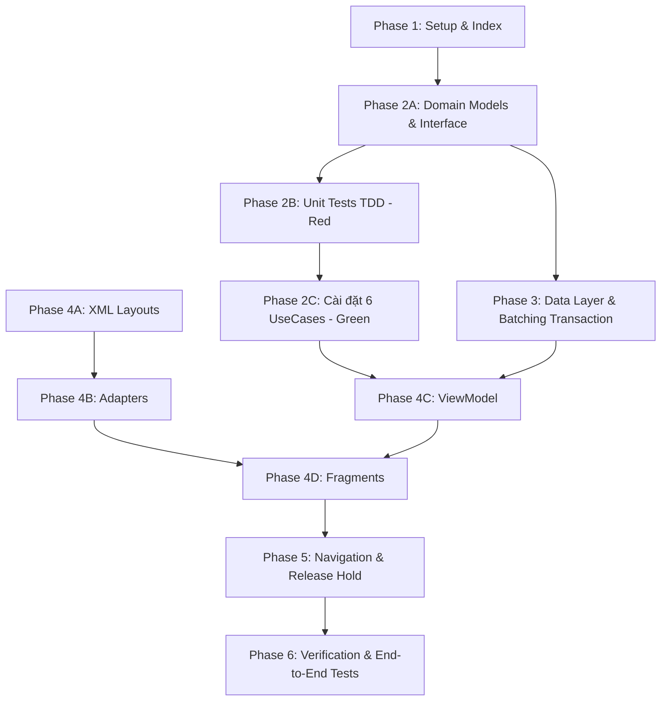

# Tasks: Đặt sân cố định theo tuần (Spec 041)

**Input**: Tài liệu thiết kế trong `specs/041-weekly-recurring-booking/`: [plan.md](plan.md), [spec.md](spec.md), [research.md](research.md), [data-model.md](data-model.md), [contracts/ui-contracts.md](contracts/ui-contracts.md), [quickstart.md](quickstart.md).

**Tests & Architecture Guidelines**:
- **Constitution I (Clean Architecture)**: Tầng `domain` hoàn toàn thuần Kotlin, độc lập với Android framework và Firebase SDK. UseCases độc lập, có thể unit test 100% bằng JUnit4 + MockK + Turbine.
- **Constitution II & III (Money & Atomic Transaction)**: Toàn bộ số tiền (`subtotalAmount`, `depositAmount`) bắt buộc dùng kiểu `Long` (VND, cấm âm). Giao dịch Firestore Transaction giữ chỗ chu kỳ phải tuân thủ nghiêm ngặt nguyên tắc **All Reads Before All Writes**, **All-or-Nothing** và kiểm soát số lượng thao tác an toàn dưới trần **500 operations**.
- **Quy tắc chu kỳ cố định & Giải quyết xung đột**:
  - Chọn 1 hoặc nhiều thứ trong tuần, khung giờ cố định từ 2 đến 6 slot 30 phút (1h đến 3h/buổi), chu kỳ từ 4 đến 12 tuần (hỗ trợ bắt đầu từ tuần này hoặc tuần sau; tự động bỏ qua các thứ đã qua trong tuần hiện tại).
  - Tự động tìm sân thay thế cùng loại mặt sân `surfaceType` (Phương án 1.A) hoặc cho phép người chơi bỏ qua buổi trùng (giảm trừ tiền tương ứng).
  - Bắt buộc phải còn **tối thiểu 4 buổi hợp lệ** mới cho phép tạo đơn; nếu ít hơn 4 buổi sẽ chặn luồng và gợi ý chuyển sang đặt sân lẻ (Spec 040).
- **Quy trình Test-First (TDD)**: Viết Unit Test cho UseCase trước ở Phase 2, chạy thấy fail, sau đó cài đặt logic để test chuyển sang màu xanh.

---

## Quy ước viết tắt đường dẫn

| Viết tắt | Đường dẫn thực tế |
|---|---|
| `APP/` | `app/src/main/java/com/example/booking_app/` |
| `CORE/` | `app/src/main/java/com/example/booking_app/core/` |
| `BOOKING/` | `app/src/main/java/com/example/booking_app/feature/booking/` |
| `RES/` | `app/src/main/res/` |
| `TEST/` | `app/src/test/java/com/example/booking_app/` |
| `ATEST/` | `app/src/androidTest/java/com/example/booking_app/` |

---

## Danh sách công việc theo User Stories & Phases

```
US1: Cấu hình lịch cố định theo tuần (P1)
US2: Kiểm tra khả dụng toàn chu kỳ & giải quyết xung đột lịch (P1)
US3: Giữ chỗ chuỗi buổi chơi 5 phút với nguyên tắc All-or-Nothing (P1)
US4: Giải phóng giữ chỗ chủ động & xử lý hết hạn phiên giữ chỗ 5 phút (P2)
US5: Tóm tắt chi phí, cọc 30% và chuyển tiếp sang thanh toán Spec 050 (P2)
```

---

## Phase 1: Setup & Data Infrastructure (Nền tảng dự án)

**Mục tiêu**: Chuẩn bị cấu hình dự án, fixtures dữ liệu giả lập chu kỳ dài hạn (4–12 tuần) và khai báo Composite Index.

- [ ] T001 [P] Kiểm tra các thư viện phục vụ chu kỳ và bất đồng bộ: Kotlin Coroutines (`async/awaitAll`), Material 3 (Slider, ChipGroup), Turbine, MockK.
- [ ] T002 [P] Xác nhận cấu hình Composite Index trong `firestore.indexes.json` cho collection `slots` (`venueId`, `date`, `startTime`) phục vụ quét song song nhiều ngày.
- [ ] T003 [P] Tạo bộ test fixtures `TEST/feature/booking/fixture/RecurringBookingFixtures.kt`: Cung cấp dữ liệu mẫu cho `RecurringConfig` (4 tuần, T3-T5, 18:00–20:00), danh sách sân con với các loại mặt sân (`WOOD`, `MAT`, `PU`), và danh sách slot bận giả lập có xung đột.

**Checkpoint**: Chạy `./gradlew assembleDebug` thành công, bộ fixtures sẵn sàng.

---

## Phase 2: Domain Layer & Core Business Logic (Kiến trúc thuần Kotlin & TDD)

**Mục tiêu**: Xây dựng toàn bộ Entities, Repository Interfaces và 6 UseCases thuần Kotlin tại tầng Domain. Viết Unit Tests trước theo quy chuẩn TDD.

### 2A. Domain Models & Repository Interface
- [ ] T004 [P] Định nghĩa các Domain Models trong `BOOKING/domain/model/`:
  - `RecurringConfig.kt` (`venueId`, `dayOfWeeks: List<Int>`, `startTime`, `endTime`, `slotCount: Int`, `courtId`, `totalWeeks: Int`, `startNextWeek: Boolean`)
  - `RecurringSession.kt` (`date: LocalDate`, `dayOfWeek: Int`, `startTime`, `endTime`, `courtId`, `courtName`, `surfaceType`, `slotIds: List<String>`, `price: Long`, `status: RecurringSessionStatus`)
  - `RecurringSessionStatus.kt` (`AVAILABLE`, `SUGGEST_CHANGE_COURT`, `MUST_SKIP`, `EXCLUDED`, `HELD`)
  - `RecurringConflict.kt` (`sessionDate: LocalDate`, `originalCourtId`, `suggestedCourts: List<Court>`, `mustSkip: Boolean`)
  - `RecurringSummary.kt` (`totalSessions: Int`, `validSessions: List<RecurringSession>`, `subtotalAmount: Long`, `depositAmount: Long`, `canProceed: Boolean`, `warningMessage: String?`)
  - `RecurringHoldResult.kt` (`Success(recurringGroupId: String, holdExpiresAtMillis: Long)`, `Conflict(conflictedSessionDates: List<LocalDate>)`)
- [ ] T005 [P] Định nghĩa Interface `BOOKING/domain/repository/RecurringBookingRepository.kt`:
  - `suspend fun getActiveCourts(venueId: String): Result<List<Court>>`
  - `suspend fun getPriceRules(venueId: String): Result<List<PriceRule>>`
  - `suspend fun getBusySlotsForDates(venueId: String, dates: List<String>): Result<List<TimeSlot>>`
  - `suspend fun holdRecurringBookingTransaction(venueId: String, config: RecurringConfig, sessions: List<RecurringSession>, userId: String, requestId: String): Result<RecurringHoldResult>`
  - `suspend fun releaseRecurringHold(recurringGroupId: String, slotIds: List<String>, userId: String): Result<Unit>`

### 2B. Unit Tests (Viết trước, phải FAIL)
- [ ] T006 [P] [US1] Viết Unit Test `TEST/feature/booking/domain/GenerateRecurringSessionsUseCaseTest.kt`:
  - Sinh đúng danh sách ngày cho chu kỳ 4 tuần với Thứ 3 & Thứ 5 (đủ 8 buổi nếu bắt đầu tuần sau).
  - Chọn bắt đầu tuần hiện tại: Tự động bỏ qua các thứ đã qua trong tuần hoặc ca đã qua giờ hôm nay.
  - Chọn bắt đầu từ tuần tiếp theo: Sinh đầy đủ tất cả các thứ được chọn bắt đầu từ thứ Hai tuần sau.
  - Ràng buộc khung giờ: Chấp nhận từ 2 đến 6 slot 30 phút (1h đến 3h); từ chối nếu < 2 slot hoặc > 6 slot.
  - Ràng buộc chu kỳ: Chấp nhận từ 4 đến 12 tuần; từ chối nếu < 4 tuần hoặc > 12 tuần.
- [ ] T007 [P] [US2] Viết Unit Test `TEST/feature/booking/domain/CheckRecurringAvailabilityUseCaseTest.kt`:
  - Sân ưu tiên còn trống toàn bộ các slot của buổi $\rightarrow$ Trạng thái buổi là `AVAILABLE`.
  - Sân ưu tiên có ít nhất 1 slot bị `BOOKED`/`BLOCKED` $\rightarrow$ Tự động quét các sân khác trong cùng cơ sở:
    - Tìm thấy sân khác còn trống trọn vẹn khung giờ $\rightarrow$ Đưa vào trạng thái `SUGGEST_CHANGE_COURT`.
    - Tất cả các sân con đều bị vướng ít nhất 1 slot $\rightarrow$ Đưa vào trạng thái `MUST_SKIP`.
- [ ] T008 [P] [US2] Viết Unit Test `TEST/feature/booking/domain/ResolveRecurringConflictUseCaseTest.kt`:
  - Đổi sân: Ưu tiên chọn sân thay thế cùng loại mặt sân `surfaceType` (Phương án 1.A); đơn giá buổi giữ nguyên không đổi.
  - Bỏ buổi trùng lịch: Trừ số buổi và giảm tổng tiền tương ứng.
  - Ràng buộc tối thiểu 4 buổi: Nếu sau khi bỏ buổi mà số buổi hợp lệ $< 4$ $\rightarrow$ Báo lỗi không đủ điều kiện đặt cố định và đề xuất quay về đặt sân lẻ (040).
- [ ] T009 [P] [US5] Viết Unit Test `TEST/feature/booking/domain/CalculateRecurringPriceUseCaseTest.kt`:
  - Tính tổng tiền của toàn bộ các buổi hợp lệ theo `PriceRule` 30 phút.
  - Tính cọc 30% làm tròn an toàn theo công thức `((rawDeposit + 500) / 1000) * 1000` (VND, kiểu `Long`).
- [ ] T010 [P] [US3] Viết Unit Test `TEST/feature/booking/domain/CreateRecurringHoldTransactionUseCaseTest.kt`:
  - Toàn bộ buổi hợp lệ đều trống $\rightarrow$ Giữ chỗ thành công toàn chu kỳ trong 5 phút, trả về `recurringGroupId`.
  - 1 trong các buổi có slot bị người khác chiếm trước $\rightarrow$ Rollback toàn bộ (All-or-Nothing), trả về danh sách ngày bị mất.
- [ ] T011 [P] [US4] Viết Unit Test `TEST/feature/booking/domain/ReleaseRecurringHoldUseCaseTest.kt`:
  - Giải phóng toàn bộ các slot đã giữ về trạng thái `AVAILABLE` khi người dùng bấm Hủy hoặc thoát app.

### 2C. Cài đặt UseCases (Làm cho Unit Tests chuyển sang XANH)
- [ ] T012 Cài đặt `BOOKING/domain/usecase/GenerateRecurringSessionsUseCase.kt`. Chạy T006 chuyển sang xanh.
- [ ] T013 Cài đặt `BOOKING/domain/usecase/CheckRecurringAvailabilityUseCase.kt`. Chạy T007 chuyển sang xanh.
- [ ] T014 Cài đặt `BOOKING/domain/usecase/ResolveRecurringConflictUseCase.kt`. Chạy T008 chuyển sang xanh.
- [ ] T015 Cài đặt `BOOKING/domain/usecase/CalculateRecurringPriceUseCase.kt`. Chạy T009 chuyển sang xanh.
- [ ] T016 Cài đặt `BOOKING/domain/usecase/CreateRecurringHoldTransactionUseCase.kt`. Chạy T010 chuyển sang xanh.
- [ ] T017 Cài đặt `BOOKING/domain/usecase/ReleaseRecurringHoldUseCase.kt`. Chạy T011 chuyển sang xanh.

**Checkpoint**: Toàn bộ Unit Test tầng Domain của Feature 041 pass 100%.

---

## Phase 3: Data Layer & Infrastructure (Thực thi Repository & Firestore Batching)

**Mục tiêu**: Xây dựng DTOs, Mappers, Remote Data Source hỗ trợ chia batch query song song và Firestore Transaction kiểm soát dưới 500 operations.

- [ ] T018 [P] Tạo các DTOs trong `BOOKING/data/model/`:
  - `RecurringGroupDto.kt` (`@DocumentId id`, `userId`, `venueId`, `venueName`, `daysOfWeek`, `startTime`, `endTime`, `startDate`, `endDate`, `totalSessions`, `subtotal`, `depositAmount`, `paymentStatus`, `status`, `holdExpiresAt`, `requestId`, `createdAt`)
  - `BookingSessionDto.kt` (`@DocumentId id`, `recurringGroupId`, `userId`, `venueId`, `courtId`, `courtName`, `date`, `startTime`, `endTime`, `slotIds`, `status`, `price`, `depositAmount`)
- [ ] T019 [P] Cài đặt `BOOKING/data/mapper/RecurringBookingMapper.kt`: Chuyển đổi giữa DTOs và Domain Entities.
- [ ] T020 Cài đặt truy vấn song song trong `BOOKING/data/datasource/RecurringBookingRemoteDataSource.kt`:
  - Chia danh sách ngày cần kiểm tra thành các chunk: `dates.chunked(30)`.
  - Sử dụng `coroutineScope` kết hợp `dates.chunked(30).map { chunk -> async { firestore.collection("slots").whereIn("date", chunk)... } }.awaitAll()` để vượt giới hạn 30 phần tử của Firestore và phản hồi dưới 2 giây.
- [ ] T021 Cài đặt Firestore Transaction giữ chỗ All-or-Nothing trong `RecurringBookingRemoteDataSource.kt`:
  - **Pha 1 (ALL READS)**: Đọc toàn bộ các document `slots/{courtId}_{yyyyMMdd}_{HHmm}` của tất cả các buổi hợp lệ. Xác minh không có slot nào đang `BOOKED`, `BLOCKED`, hoặc `HELD` còn hạn.
  - **Pha 2 (ALL WRITES)**: Tạo document `recurringGroups/{recurringGroupId}`, tạo các document con `bookings/{bookingId}`, và ghi đồng loạt các document `slots` sang `status = "HELD"` với `holdExpiresAt = serverNow + 5 phút`. Kiểm soát tổng số thao tác đọc + ghi luôn dưới 500 ops.
- [ ] T022 Cài đặt `BOOKING/data/repository/RecurringBookingRepositoryImpl.kt` hiện thực hóa interface tầng domain.
- [ ] T023 [P] Cập nhật DI Module `BOOKING/di/RecurringBookingModule.kt`: Cung cấp `RecurringBookingRepositoryImpl` và 6 UseCases cho Hilt.

**Checkpoint**: Tích hợp Data Layer hoàn tất, batching query và Transaction sẵn sàng.

---

## Phase 4: UI Layer & ViewModels (Giao diện Cấu hình & Xử lý Xung đột)

**Mục tiêu**: Xây dựng màn hình cấu hình lịch tuần, BottomSheet giải quyết xung đột đổi sân, màn hình xác nhận đếm ngược 5 phút và ViewModel.

### 4A. Layout XML & Resources
- [ ] T024 [P] [US1] Tạo `RES/layout/item_day_of_week_chip.xml`: Chip chọn thứ (T2, T3, T4, T5, T6, T7, CN) với trạng thái active/inactive Material 3.
- [ ] T025 [P] [US1] Tạo `RES/layout/fragment_booking_recurring_config.xml`:
  - ChipGroup chọn thứ trong tuần.
  - Spinner/Picker chọn giờ bắt đầu và giờ kết thúc (2–6 slot 30 phút).
  - Spinner chọn sân con ưu tiên.
  - Slider/NumberPicker chọn số tuần (4 đến 12 tuần) kèm Switch bắt đầu từ tuần này hay tuần sau.
  - Nút "Kiểm tra khả dụng" có trạng thái loading.
- [ ] T026 [P] [US2] Tạo `RES/layout/item_recurring_conflict.xml`: Thẻ hiển thị buổi bị trùng lịch, tên sân ưu tiên bị bận, RadioGroup chọn: "Đổi sang [Tên sân thay thế] (Cùng loại mặt sân)" hoặc "Bỏ qua buổi này".
- [ ] T027 [P] [US2] Tạo `RES/layout/bottom_sheet_recurring_conflict.xml`: BottomSheet hiển thị danh sách các buổi bị xung đột lịch và nút "Áp dụng phương án".
- [ ] T028 [P] [US3, US5] Tạo `RES/layout/item_recurring_session_summary.xml`: Dòng hiển thị chi tiết 1 buổi trong chuỗi (Thứ, Ngày, Giờ, Tên sân, Giá tiền).
- [ ] T029 [P] [US3, US5] Tạo `RES/layout/fragment_booking_recurring_confirm.xml`: Màn hình xác nhận chu kỳ:
  - Banner đồng hồ đếm ngược 5 phút (`05:00`).
  - Danh sách các buổi hợp lệ.
  - Tổng số buổi, tổng tiền và tiền cọc 30%.
  - Nút "Xác nhận & Thanh toán" và nút "Hủy".
- [ ] T030 [P] [US1] Bổ sung chuỗi văn bản trong `RES/values/strings_recurring.xml`.

### 4B. Adapters
- [ ] T031 [P] [US1] Cài đặt `BOOKING/ui/recurring/adapter/DayOfWeekChipAdapter.kt`: Quản lý chọn nhiều thứ trong tuần.
- [ ] T032 [P] [US2] Cài đặt `BOOKING/ui/recurring/adapter/ConflictResolutionAdapter.kt`: `ListAdapter` hiển thị các buổi xung đột và xử lý chọn đổi sân / bỏ buổi.
- [ ] T033 [P] [US3] Cài đặt `BOOKING/ui/recurring/adapter/RecurringSessionSummaryAdapter.kt`: `ListAdapter` hiển thị tóm tắt toàn bộ các buổi trong chu kỳ.

### 4C. ViewModel & UI State
- [ ] T034 [P] [US1–US5] Định nghĩa `BookingRecurringUiState.kt` và `BookingRecurringUiEffect.kt`:
  - `BookingRecurringUiState`: `config`, `isCheckingAvailability`, `conflicts: List<RecurringConflict>`, `validSessions: List<RecurringSession>`, `subtotalAmount: Long`, `depositAmount: Long`, `isHolding: Boolean`, `holdCountdownSeconds: Int`, `errorMessage: String?`.
  - `BookingRecurringUiEffect`: `ShowConflictBottomSheet`, `NavigateToConfirmation`, `NavigateToPayment(HoldToPaymentArgs)`, `NavigateBackToGrid`, `ShowToast`, `ShowErrorDialog`.
- [ ] T035 [US1–US5] Cài đặt `BOOKING/ui/recurring/BookingRecurringViewModel.kt`:
  - Xử lý cấu hình chu kỳ và kích hoạt `CheckRecurringAvailabilityUseCase`.
  - Nhận kết quả xung đột $\rightarrow$ phát `UiEffect.ShowConflictBottomSheet`.
  - Cập nhật phương án đổi sân / bỏ buổi và tính lại tổng tiền. Kiểm tra điều kiện chặn $< 4$ buổi.
  - Kích hoạt `CreateRecurringHoldTransactionUseCase` khi sang màn hình xác nhận.
  - Quản lý Ticker Flow đếm ngược 5 phút; tự động gọi `ReleaseRecurringHoldUseCase` nếu chạm 00:00 hoặc người dùng bấm Hủy.

### 4D. Fragments
- [ ] T036 [US1, US2] Cài đặt `BOOKING/ui/recurring/BookingRecurringConfigFragment.kt` và `BookingRecurringConflictBottomSheet.kt`.
- [ ] T037 [US3, US4, US5] Cài đặt `BOOKING/ui/recurring/BookingRecurringConfirmFragment.kt`: Quan sát đếm ngược 5 phút, hiển thị danh sách các buổi và nút chuyển sang thanh toán.

**Checkpoint**: Toàn bộ luồng cấu hình, giải quyết xung đột đổi sân và xác nhận giữ chỗ hoạt động mượt mà.

---

## Phase 5: Navigation, Integration & Edge Cases (Xử lý Ngoại lệ & Chuyển giao)

**Mục tiêu**: Kết nối chuyển giao sang Spec 050, cơ chế chủ động giải phóng chỗ và xử lý sự cố mạng.

- [ ] T038 [P] [US5] Cấu hình Navigation Safe Args trong `RES/navigation/nav_player.xml`:
  - Action chuyển tiếp sang `PaymentFragment` (Spec 050) truyền `HoldToPaymentArgs` với `isRecurring = true`, `totalSessions`, `subtotalAmount`, `depositAmount`.
- [ ] T039 [US4] Cài đặt cơ chế chủ động giải phóng giữ chỗ (`OnBackPressedCallback`):
  - Khi người dùng bấm nút Quay lại (Back) hoặc nút Hủy từ màn hình xác nhận, app lập tức gọi `ReleaseRecurringHoldUseCase` để nhả toàn bộ các slot đang giữ, tránh treo sân suốt 5 phút.
- [ ] T040 [US5] Xử lý rớt mạng và Idempotency:
  - Sinh mã `requestId` duy nhất (UUID) cho mỗi lần xác nhận giữ chỗ chu kỳ để chống tạo trùng lặp nhóm và đơn khi retry mạng.

**Checkpoint**: Các luồng biên, thoát màn hình và giải phóng tài nguyên hoạt động an toàn.

---

## Phase 6: System Verification, Automated Tests & Polish (Nghiệm thu Hệ thống)

**Mục tiêu**: Chạy toàn bộ test suites, kiểm thử tranh chấp chuỗi lịch trên Firebase Emulator và đối soát checklist.

- [ ] T041 [P] Viết Unit Test `TEST/feature/booking/ui/recurring/BookingRecurringViewModelTest.kt`:
  - Kiểm thử chọn thứ, giờ, chu kỳ và tự động sinh buổi.
  - Kiểm thử nhận diện xung đột lịch và cập nhật phương án đổi sân cùng `surfaceType`.
  - Kiểm thử chặn nút tiếp tục khi số buổi hợp lệ $< 4$.
- [ ] T042 [P] Viết Integration Test `TEST/feature/booking/data/RecurringHoldTransactionTest.kt` chạy trên Firebase Emulator:
  - Kiểm thử giữ chỗ chu kỳ 12 tuần All-or-Nothing.
  - Kiểm thử rollback khi có 1 slot bất kỳ trong chu kỳ bị người khác giữ trước.
- [ ] T043 Viết UI Test Espresso `ATEST/feature/booking/BookingRecurringFlowTest.kt`:
  - Thao tác cấu hình lịch, mở BottomSheet đổi sân, chuyển sang màn hình xác nhận đếm ngược 5 phút.
- [ ] T044 Rà soát checklist chất lượng trong `specs/041-weekly-recurring-booking/checklists/` và chạy toàn bộ unit tests: `./gradlew testDebugUnitTest --tests "com.example.booking_app.feature.booking.*"`.

---

## Thứ tự Phụ thuộc & Thực thi Song song

### Sơ đồ phụ thuộc giữa các Phase:


### Các nhóm Task có thể thực hiện song song (`[P]`):
1. **Domain Setup & Tests**: `T004`, `T005`, `T006`, `T007`, `T008`, `T009`, `T010`, `T011` có thể viết đồng thời.
2. **Data & Infrastructure**: `T018`, `T019`, `T023` có thể triển khai song song với UI.
3. **UI Layouts & Adapters**: `T024`, `T025`, `T026`, `T027`, `T028`, `T029`, `T030`, `T031`, `T032`, `T033` có thể thiết kế độc lập trước khi ráp vào Fragment và ViewModel.
4. **Verification Tests**: `T041` và `T042` có thể viết song song sau khi hoàn tất ViewModel và Data Source.
