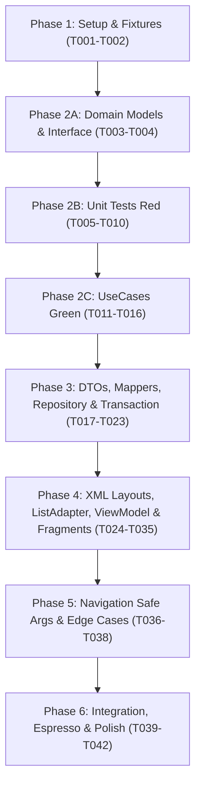

# Tasks: Thanh toán và Khuyến mãi giả lập (Spec 050)

**Input**: Tài liệu thiết kế trong `specs/050-payment-voucher/`: [plan.md](plan.md), [spec.md](spec.md), [research.md](research.md), [data-model.md](data-model.md), [contracts/ui-contracts.md](contracts/ui-contracts.md), [quickstart.md](quickstart.md).

**Tests & Architecture Guidelines**:
- **Constitution I (Clean Architecture)**: Tầng `domain` hoàn toàn thuần Kotlin, tuyệt đối không import Android SDK (`Context`, `View`, `Bundle`) hay Firebase SDK (`Timestamp`, `DocumentSnapshot`). UseCases độc lập, có thể unit test 100% bằng JUnit4 + MockK + Turbine.
- **Constitution II & III (Money & Atomic Transaction)**: Toàn bộ số tiền (`subtotalAmount`, `discountAmount`, `payableAmount`, `depositAmount`, `walletBalance`) bắt buộc sử dụng kiểu `Long` (VND, cấm âm, cấm `Double`/`Float`).
- **Giao dịch Firestore Transaction nguyên tử (Atomic 2 pha)**:
  + **Pha Đọc (All Reads)**: Kiểm tra idempotency (`users/{userId}/walletTransactions/{requestId}`), kiểm tra hạn giữ chỗ (`holdExpiresAt > now`), đọc danh sách `slots` đang `HOLD`, kiểm tra voucher (`usedCount < usageLimit` và `userUsage/{userId}.count < perUserLimit`), kiểm tra số dư ví (`walletBalance >= requiredAmount`).
  + **Pha Ghi (All Writes)**: Trừ số dư ví, ghi log `walletTransactions/{requestId}`, tăng lượt voucher & ghi `redemptions/{bookingId}`, chuyển đơn/nhóm đơn sang `PENDING` (chờ duyệt 60 phút theo Phương án 2.A), chuyển toàn bộ `slots` sang `BOOKED` (xóa `holdExpiresAt`). Đảm bảo tổng số operations dưới trần 500 ops.
- **Idempotency & Chống trừ trùng (US5)**: Sử dụng `requestId` UUID từ client làm khóa kiểm tra duy nhất trong Transaction, xử lý an toàn khi mất mạng hoặc người dùng click liên tục; bảo đảm số dư ví không bao giờ bị âm.
- **Xử lý Biên Voucher Phút chót (Commit-time Invalidation)**: Nếu voucher bị người khác lấy mất lượt cuối cùng hoặc hết hạn giữa lúc áp dụng và lúc bấm xác nhận, Transaction ném `VoucherInvalidException`. ViewModel bắt lỗi này, phát `UiEffect` hiển thị Dialog thông báo và cập nhật lại bảng phân bổ tiền theo giá gốc.
- **Ticker Đếm ngược & Giải phóng Slot**: Ticker tính theo `remainingMillis = holdExpiresAtMillis - System.currentTimeMillis()`, tuyệt đối cấm khởi tạo 5 phút mới. Chạm 00:00 $\rightarrow$ vô hiệu hóa nút thanh toán và gọi `CancelPaymentHoldUseCase` để giải phóng slot.
- **Quy tắc Voucher 2 nguồn (Phương án 3.B)**: Đọc song song từ cơ sở (`venues/{venueId}/vouchers/{code}`) và toàn sàn (`systemVouchers/{code}`), ưu tiên voucher cơ sở. Kiểm tra `validFrom`/`validUntil`, `minOrderTotal`, trần giảm giá `maxDiscount`.
- **Tùy biến phương thức thanh toán**: `AT_VENUE` (chỉ áp dụng cho đơn lẻ 040, ẩn với đơn chu kỳ 041), `DEPOSIT` (30% làm tròn nghìn đồng an toàn: `((rawDeposit + 500) / 1000) * 1000`), và `MOCK_WALLET` (100%). Nếu sau giảm giá = 0đ $\rightarrow$ tự động chuyển sang `FREE`.
- **Cam kết học tập phi thương mại (Constitution VI)**: Thanh toán thuần GIẢ LẬP, hiển thị banner nổi bật *"Giao dịch giả lập phục vụ học tập - Không thu tiền thật"* trên màn hình thanh toán và E-Receipt; cung cấp BottomSheet "Nạp ví giả lập" (+100k, +500k, +1M).

---

## Quy ước viết tắt đường dẫn

| Viết tắt | Đường dẫn thực tế |
|---|---|
| `APP/` | `app/src/main/java/com/example/booking_app/` |
| `CORE/` | `app/src/main/java/com/example/booking_app/core/` |
| `PAYMENT/` | `app/src/main/java/com/example/booking_app/feature/payment/` |
| `RES/` | `app/src/main/res/` |
| `TEST/` | `app/src/test/java/com/example/booking_app/` |
| `ATEST/` | `app/src/androidTest/java/com/example/booking_app/` |

---

## Danh sách công việc theo User Stories & Phases

```
US1: Áp dụng mã khuyến mãi (Voucher) cho đơn đặt sân (P1) 🎯 MVP
US2: Lựa chọn phương thức thanh toán và xác nhận giao dịch giả lập (P1)
US3: Xử lý hết hạn giữ chỗ trong lúc thanh toán (P1)
US4: Nạp tiền vào ví giả lập và xử lý số dư không đủ (P2)
US5: Đảm bảo tính toàn vẹn giao dịch và chống trừ tiền trùng lặp (P3)
```

---

## Phase 1: Setup & Test Infrastructure (Nền tảng hạ tầng)

**Mục tiêu**: Thiết lập cấu hình Composite Index cho lịch sử ví và khuyến mãi, chuẩn bị dữ liệu mẫu và môi trường kiểm thử giả lập.

- [ ] T001 Khai báo Composite Index cho Firestore trong `firestore.indexes.json`:
  - `walletTransactions`: `userId` (ASC), `createdAt` (DESC) phục vụ truy vấn lịch sử giao dịch.
  - `venues/{venueId}/vouchers`: `isActive` (ASC), `validUntil` (ASC) phục vụ lọc voucher còn hạn.
  - `systemVouchers`: `isActive` (ASC), `validUntil` (ASC) phục vụ lọc voucher toàn hệ thống.
  *Verify*: `firebase deploy --only firestore:indexes --dry-run` hoặc file JSON hợp lệ.
- [ ] T002 [P] Tạo bộ test fixtures `TEST/feature/payment/fixture/PaymentFixtures.kt`: Cung cấp dữ liệu mẫu cho `VoucherDto`, `VoucherRedemptionDto`, `WalletTransactionDto`, `HoldToPaymentArgs`, mock snapshots của `users/{userId}` với số dư 0đ và 500k, voucher cơ sở `GIAM20` (giảm 20% max 40k), voucher toàn hệ thống `CHAOBAN` (giảm 50k), đơn giữ chỗ ngày lẻ và chu kỳ cố định.
  *Verify*: File biên dịch độc lập không lỗi cú pháp.

**Checkpoint**: Sẵn sàng hạ tầng dữ liệu và fixtures phục vụ TDD cho Phase 2.

---

## Phase 2: Domain Layer & Core Business Logic (Kiến trúc thuần Kotlin & TDD)

**Mục tiêu**: Xây dựng toàn bộ Domain Models, Repository Interface và UseCases thuần Kotlin. Viết Unit Tests trước theo tôn chỉ Test-First (TDD Red), sau đó cài đặt UseCases (Green).

### 2A. Domain Models & Repository Interface
- [ ] T003 [P] Định nghĩa các Domain Models thuần Kotlin trong `PAYMENT/domain/model/`:
  - `Voucher.kt` (`code`, `name`, `description`, `scope`: Enum `VENUE` / `SYSTEM`, `discountType`: Enum `PERCENT` / `FIXED_AMOUNT`, `discountValue`: Long, `maxDiscount`: Long?, `minOrderTotal`: Long, `validFrom`: Long, `validUntil`: Long, `usageLimit`: Int, `usedCount`: Int, `perUserLimit`: Int, `isActive`: Boolean)
  - `VoucherValidationResult.kt` (Sealed class: `Valid`, `NotFound`, `Expired`, `NotStarted`, `MinOrderNotMet`, `UsageLimitReached`, `PerUserLimitReached`, `Inactive`)
  - `PaymentMethod.kt` (Enum: `AT_VENUE`, `DEPOSIT`, `MOCK_WALLET`, `FREE`)
  - `PaymentBreakdown.kt` (`subtotalAmount`: Long, `discountAmount`: Long, `payableAmount`: Long, `depositAmount`: Long, `remainingAmount`: Long, `method`: PaymentMethod)
  - `PaymentReceipt.kt` (`receiptId`: String, `bookingId`: String, `isRecurring`: Boolean, `venueName`: String, `totalSessions`: Int, `subtotalAmount`: Long, `discountAmount`: Long, `depositAmount`: Long, `finalPaidAmount`: Long, `method`: PaymentMethod, `status`: String, `paidAt`: Long, `note`: String)
  - `WalletTransaction.kt` (`txId`: String, `userId`: String, `amount`: Long, `type`: Enum `TOP_UP` / `DEPOSIT` / `PAYMENT` / `REFUND`, `bookingId`: String?, `balanceAfter`: Long, `createdAt`: Long)
  *Verify*: File thuần Kotlin, không import `android.*` hay `com.google.firebase.*`.
- [ ] T004 [P] Định nghĩa `PaymentRepository.kt` interface trong `PAYMENT/domain/repository/`:
  - `getWalletBalance(userId: String): Result<Long>`
  - `topUpMockWallet(userId: String, amount: Long): Result<Long>`
  - `getAvailableVouchers(venueId: String): Result<List<Voucher>>`
  - `getVoucherByCode(code: String, venueId: String): Result<Voucher?>`
  - `getUserVoucherUsageCount(code: String, userId: String): Result<Int>`
  - `processPaymentTransaction(userId: String, bookingId: String, isRecurring: Boolean, method: PaymentMethod, requiredAmount: Long, voucher: Voucher?, depositAmount: Long, discountAmount: Long, payableAmount: Long, slotIds: List<String>, requestId: String): Result<PaymentReceipt>`
  - `cancelPaymentHold(bookingId: String, isRecurring: Boolean, slotIds: List<String>): Result<Unit>`
  *Verify*: Interface độc lập thuần Kotlin, không import Android/Firebase SDK.

### 2B. Unit Tests trước cho UseCases (TDD Red)
- [ ] T005 [P] [US1] Viết Unit Test `TEST/feature/payment/usecase/ValidateAndApplyVoucherUseCaseTest.kt`:
  - Test voucher giảm theo % (đơn 300k giảm 10% $\rightarrow$ giảm 30k).
  - Test voucher chạm trần `maxDiscount` (đơn 150k giảm 50% max 40k $\rightarrow$ giảm đúng 40k).
  - Test voucher giảm số tiền cố định (đơn 80k giảm 100k $\rightarrow$ giảm 80k, payable = 0đ, không âm).
  - Test voucher từ chối khi chưa đạt `minOrderTotal`, hết hạn, hết tổng lượt dùng, hoặc vượt `perUserLimit`.
  *Verify*: Chạy `./gradlew testDebugUnitTest --tests "*.ValidateAndApplyVoucherUseCaseTest"` báo Red (chưa có code cài đặt).
- [ ] T006 [P] [US1] Viết Unit Test `TEST/feature/payment/usecase/GetAvailableVouchersUseCaseTest.kt`:
  - Test đọc song song từ 2 nguồn (cơ sở và hệ thống), lọc bỏ voucher hết hạn/vô hiệu, ưu tiên voucher cơ sở nếu trùng mã code.
  *Verify*: Chạy `./gradlew testDebugUnitTest --tests "*.GetAvailableVouchersUseCaseTest"` báo Red.
- [ ] T007 [P] [US2] Viết Unit Test `TEST/feature/payment/usecase/CalculatePaymentBreakdownUseCaseTest.kt`:
  - Test tính cọc 30% làm tròn chuẩn nghìn đồng: đơn 200k $\rightarrow$ cọc 60k; đơn 175k $\rightarrow$ cọc 53k, còn lại trả tại sân 122k.
  - Test đơn sau voucher = 0đ $\rightarrow$ cọc 0đ, phương thức tự chuyển `FREE`.
  - Test đơn chọn `MOCK_WALLET` $\rightarrow$ payable = 100%, cọc = 0.
  - Test đơn chọn `AT_VENUE` $\rightarrow$ cọc = 0, payable trả tại sân.
  *Verify*: Chạy `./gradlew testDebugUnitTest --tests "*.CalculatePaymentBreakdownUseCaseTest"` báo Red.
- [ ] T008 [P] [US4] Viết Unit Test `TEST/feature/payment/usecase/TopUpMockWalletUseCaseTest.kt`:
  - Test nạp các mệnh giá hợp lệ (100k, 500k, 1M) vào ví giả lập, cộng dồn chính xác số dư và từ chối số tiền $\le 0$đ.
  *Verify*: Chạy `./gradlew testDebugUnitTest --tests "*.TopUpMockWalletUseCaseTest"` báo Red.
- [ ] T009 [P] [US3] Viết Unit Test `TEST/feature/payment/usecase/CancelPaymentHoldUseCaseTest.kt`:
  - Test giải phóng slot giữ chỗ khi hủy đơn hoặc hết hạn 5 phút.
  *Verify*: Chạy `./gradlew testDebugUnitTest --tests "*.CancelPaymentHoldUseCaseTest"` báo Red.
- [ ] T010 [P] [US2] [US5] Viết Unit Test `TEST/feature/payment/usecase/ProcessMockPaymentUseCaseTest.kt`:
  - Test thanh toán thành công với từng phương thức (`AT_VENUE`, `DEPOSIT`, `MOCK_WALLET`, `FREE`).
  - Test thất bại khi số dư ví không đủ $\rightarrow$ ném `InsufficientBalanceException`.
  - Test thất bại khi hết hạn giữ chỗ $\rightarrow$ ném `HoldExpiredException`.
  - Test thất bại khi voucher bị mất lượt cuối cùng tại thời điểm commit $\rightarrow$ ném `VoucherInvalidException`.
  - Test idempotency với cùng một `requestId` không trừ ví lần 2.
  *Verify*: Chạy `./gradlew testDebugUnitTest --tests "*.ProcessMockPaymentUseCaseTest"` báo Red.

### 2C. Cài đặt UseCases (TDD Green)
- [ ] T011 [P] [US1] Cài đặt `ValidateAndApplyVoucherUseCase.kt` trong `PAYMENT/domain/usecase/`: Thực hiện toàn bộ logic kiểm tra điều kiện voucher và tính số tiền giảm giá không âm, kẹp trần `maxDiscount`.
  *Verify*: `ValidateAndApplyVoucherUseCaseTest` chuyển sang Green (Pass).
- [ ] T012 [P] [US1] Cài đặt `GetAvailableVouchersUseCase.kt` trong `PAYMENT/domain/usecase/`: Gọi repository lấy voucher từ 2 nguồn, hợp nhất và lọc danh sách khả dụng.
  *Verify*: `GetAvailableVouchersUseCaseTest` chuyển sang Green (Pass).
- [ ] T013 [P] [US2] Cài đặt `CalculatePaymentBreakdownUseCase.kt` trong `PAYMENT/domain/usecase/`: Thực hiện công thức cọc 30% làm tròn an toàn `((rawDeposit + 500) / 1000) * 1000`, tự động chuyển phương thức `FREE` nếu `payableAmount == 0L`.
  *Verify*: `CalculatePaymentBreakdownUseCaseTest` chuyển sang Green (Pass).
- [ ] T014 [P] [US4] Cài đặt `TopUpMockWalletUseCase.kt` trong `PAYMENT/domain/usecase/`: Kiểm tra mệnh giá và gọi repository nạp ví giả lập.
  *Verify*: `TopUpMockWalletUseCaseTest` chuyển sang Green (Pass).
- [ ] T015 [P] [US3] Cài đặt `CancelPaymentHoldUseCase.kt` trong `PAYMENT/domain/usecase/`: Gọi repository giải phóng các slot đang `HOLD` và cập nhật đơn sang `CANCELLED`/`EXPIRED`.
  *Verify*: `CancelPaymentHoldUseCaseTest` chuyển sang Green (Pass).
- [ ] T016 [US2] [US5] Cài đặt `ProcessMockPaymentUseCase.kt` trong `PAYMENT/domain/usecase/`: Điều phối luồng thanh toán giả lập thông qua `PaymentRepository.processPaymentTransaction`, đảm bảo xử lý ngoại lệ nghiệp vụ rành mạch.
  *Verify*: `ProcessMockPaymentUseCaseTest` chuyển sang Green (Pass).

**Checkpoint**: Toàn bộ 6 UseCases tầng Domain hoàn thành và vượt qua 100% Unit Tests độc lập.

---

## Phase 3: Data Layer & Infrastructure (Thực thi Repository & Firestore Transaction)

**Mục tiêu**: Xây dựng DTOs, Mappers và cài đặt `PaymentRepositoryImpl` với Firestore Transaction 2 pha nguyên tử (All Reads Before All Writes), bảo đảm an toàn concurrency và cấu hình Hilt DI.

- [ ] T017 [P] Tạo các DTOs trong `PAYMENT/data/model/`:
  - `VoucherDto.kt` (`code`, `name`, `description`, `scope`, `discountType`, `discountValue`, `maxDiscount`, `minOrderTotal`, `validFrom`, `validUntil`, `usageLimit`, `usedCount`, `perUserLimit`, `isActive`)
  - `VoucherRedemptionDto.kt` (`bookingId`, `userId`, `code`, `discountAmount`, `redeemedAt`)
  - `WalletTransactionDto.kt` (`txId`, `userId`, `amount`, `type`, `bookingId`, `balanceAfter`, `createdAt`)
  - `UserUsageDto.kt` (`count`: Int)
  *Verify*: File biên dịch không lỗi, có constructor mặc định hỗ trợ Firestore deserialization.
- [ ] T018 [P] Tạo `PaymentMapper.kt` trong `PAYMENT/data/mapper/`: Chuyển đổi qua lại giữa `VoucherDto` $\leftrightarrow$ `Voucher`, `WalletTransactionDto` $\leftrightarrow$ `WalletTransaction`, và đóng gói `PaymentReceipt`.
  *Verify*: Viết Unit Test `PaymentMapperTest.kt` kiểm tra chuyển đổi không làm mất mát trường dữ liệu.
- [ ] T019 Xây dựng `PaymentRepositoryImpl.kt` trong `PAYMENT/data/repository/` (Phần 1 - Đọc Voucher & Ví):
  - Cài đặt `getWalletBalance`, `getVoucherByCode`, `getUserVoucherUsageCount`.
  - Cài đặt `getAvailableVouchers`: Sử dụng Coroutines `async/awaitAll` để truy vấn song song `venues/{venueId}/vouchers` và `systemVouchers`, hợp nhất danh sách và loại bỏ trùng mã.
  *Verify*: Unit Test đọc voucher 2 nguồn hoạt động chính xác với mock Firestore.
- [ ] T020 Xây dựng `PaymentRepositoryImpl.kt` trong `PAYMENT/data/repository/` (Phần 2 - Firestore Transaction Atomic 2 pha):
  - Cài đặt `processPaymentTransaction` tuân thủ nghiêm ngặt quy tắc Firestore:
    + **Pha Đọc**: Kiểm tra `walletTransactions/{requestId}` (chống trừ trùng), đọc document đơn kiểm tra `status == "HOLD"` và `holdExpiresAt > now`, đọc các `slots` kiểm tra trạng thái, đọc voucher và `userUsage/{userId}` kiểm tra hạn mức, đọc `users/{userId}` kiểm tra `walletBalance >= requiredAmount`.
    + **Pha Ghi**: Cập nhật `walletBalance` và ghi `walletTransactions/{requestId}`, tăng `usedCount` & cập nhật `userUsage` & ghi `redemptions/{bookingId}`, cập nhật đơn sang `status = "PENDING"` kèm `approvalDeadline` (60 phút theo Phương án 2.A), cập nhật các `slots` sang `BOOKED` (xóa `holdExpiresAt`).
  *Verify*: Kiểm tra logic không có bất kỳ lệnh get() nào nằm sau lệnh set()/update().
- [ ] T021 Xây dựng `PaymentRepositoryImpl.kt` trong `PAYMENT/data/repository/` (Phần 3 - Nạp ví & Hủy giữ chỗ):
  - Cài đặt `topUpMockWallet`: Chạy Transaction cộng tiền vào `users/{userId}.walletBalance` và ghi `walletTransactions` loại `TOP_UP`.
  - Cài đặt `cancelPaymentHold`: Cập nhật đơn sang `CANCELLED` và xóa/nhả các `slots` đang giữ về `AVAILABLE`.
  *Verify*: Code biên dịch hoàn tất, trả về `Result<Unit>` / `Result<Long>`.
- [ ] T022 [P] Khai báo Hilt DI Module `PaymentDataModule.kt` trong `PAYMENT/di/`: Liên kết `@Binds` `PaymentRepositoryImpl` vào `PaymentRepository` với `@Singleton` hoặc `@ViewModelScoped`.
  *Verify*: Build pass `./gradlew assembleDebug`.
- [ ] T023 [P] Cập nhật `firestore.rules`:
  - Cho phép người dùng đọc/ghi `walletTransactions` của chính mình (`request.auth.uid == userId`).
  - Cho phép đọc voucher công khai, chỉ cho phép ghi lượt dùng voucher khi `request.auth != null`.
  - Đảm bảo `walletBalance` không bao giờ âm trong Transaction rules.
  *Verify*: Chạy `firebase emulators:start --only firestore` kiểm tra cú pháp rules hợp lệ.

**Checkpoint**: Tầng Data và Repository hoàn tất, kết nối an toàn với Firestore Transaction.

---

## Phase 4: UI Layer & ViewModel (Giao diện Material 3 & Quản lý State)

**Mục tiêu**: Xây dựng XML layouts Material 3, ListAdapter, ViewModel với StateFlow quản lý Ticker đếm ngược thời gian giữ chỗ thực tế, ẩn phương thức trả tại sân cho đơn chu kỳ và xử lý nạp ví giả lập.

### 4A. XML Layouts & ListAdapters
- [ ] T024 [P] Thiết kế layout XML `RES/layout/fragment_payment_voucher.xml`:
  - Banner nổi bật: "Giao dịch giả lập phục vụ học tập - Không thu tiền thật" (Constitution VI).
  - Ticker đếm ngược thời gian giữ chỗ kèm biểu tượng đồng hồ (màu cam/đỏ khi sắp hết hạn).
  - Card thông tin đơn đặt sân: Tên sân, số buổi, tổng slot, tiền tạm tính.
  - Section Voucher: Ô nhập mã voucher kèm nút "Áp dụng", nút "Chọn từ danh sách", và chip hiển thị mã đang áp dụng kèm nút "Gỡ bỏ".
  - Section Phương thức thanh toán: `MaterialRadioGroup` gồm 3 lựa chọn: Thanh toán tại sân (`rbAtVenue`), Đặt cọc 30% (`rbDeposit`), Ví giả lập (`rbMockWallet`), và nhãn Miễn phí khi tổng tiền = 0đ.
  - Card bảng phân bổ tiền (Breakdown): Tiền gốc, Giảm giá voucher, Tiền cọc (30%), Số tiền phải thanh toán ngay, Số tiền còn lại trả tại sân.
  - Thanh dưới cùng: Tổng tiền thanh toán ngay và nút `btnConfirmPayment` ("Xác nhận thanh toán").
  *Verify*: Layout render mượt mà trên Android Studio Preview.
- [ ] T025 [P] Thiết kế layout XML `RES/layout/fragment_payment_receipt.xml`:
  - Biểu tượng thành công kèm tiêu đề "Đặt sân thành công / Chờ chủ sân duyệt".
  - Dòng lưu ý học tập phi thương mại (Constitution VI).
  - Bảng chi tiết hóa đơn: Mã đơn (`bookingId`), Mã nhóm (`recurringGroupId` nếu có), Cơ sở, Số buổi, Phương thức thanh toán, Tiền cọc đã trả, Tổng tiền, Thời gian thanh toán.
  - Nút "Xem lịch đặt của tôi" (`btnGoToMyBookings`) và nút "Về trang chủ" (`btnGoHome`).
  *Verify*: Layout hiển thị đầy đủ thông tin hóa đơn điện tử / phiếu đặt sân.
- [ ] T026 [P] Thiết kế layout XML `RES/layout/bottom_sheet_voucher_selection.xml` & `RES/layout/item_voucher.xml`:
  - Danh sách voucher khả dụng kèm nhãn phân biệt (Cơ sở / Hệ thống), hạn sử dụng, điều kiện đơn tối thiểu, nút "Áp dụng".
  *Verify*: Item layout Material 3 chuẩn đẹp.
- [ ] T027 [P] Thiết kế layout XML `RES/layout/bottom_sheet_top_up_wallet.xml`:
  - Hiển thị số dư ví hiện tại.
  - Nhóm chip mệnh giá nạp ảo: 100.000đ, 500.000đ, 1.000.000đ.
  - Nút "Xác nhận nạp ví ảo" kèm ghi chú thử nghiệm phi thương mại.
  *Verify*: Layout render rõ ràng, trực quan.
- [ ] T028 [P] Xây dựng `VoucherListAdapter.kt` trong `PAYMENT/ui/adapter/`: Kế thừa `ListAdapter` với `DiffUtil.ItemCallback<Voucher>`, bind dữ liệu voucher, xử lý sự kiện click "Áp dụng".
  *Verify*: Unit test DiffUtil kiểm tra tính toán item trùng lặp chính xác.

### 4B. ViewModel, UiState & Fragments
- [ ] T029 [P] Định nghĩa `PaymentUiState.kt` và `PaymentUiEffect.kt` trong `PAYMENT/ui/`:
  - `PaymentUiState`: `isLoading`, `bookingArgs: HoldToPaymentArgs?`, `walletBalance: Long`, `voucher: Voucher?`, `selectedMethod: PaymentMethod`, `breakdown: PaymentBreakdown?`, `remainingHoldMillis: Long`, `isHoldExpired: Boolean`, `errorMessage: String?`.
  - `PaymentUiEffect`: `ShowToast(message: String)`, `ShowVoucherInvalidDialog(reason: String)`, `NavigateToReceipt(receipt: PaymentReceipt)`, `NavigateBackToGrid(reason: String)`, `ShowTopUpBottomSheet`.
  *Verify*: Pure Kotlin sealed classes/data classes độc lập.
- [ ] T030 Xây dựng `PaymentViewModel.kt` trong `PAYMENT/ui/` (Phần 1 - Khởi tạo & Ticker đếm ngược):
  - Nhận `SavedStateHandle` lấy `HoldToPaymentArgs`.
  - Khởi tạo Ticker đếm ngược qua Kotlin Flow: `remainingMillis = holdExpiresAtMillis - System.currentTimeMillis()`. Cập nhật mỗi giây; khi $\le 0$ thì set `isHoldExpired = true`, vô hiệu hóa nút thanh toán và gọi `CancelPaymentHoldUseCase`.
  - Ẩn phương thức `AT_VENUE` nếu `bookingArgs.isRecurring == true` (ràng buộc đơn chu kỳ cố định).
  *Verify*: Viết Unit Test kiểm thử ticker đếm ngược chính xác, không tạo timer mới.
- [ ] T031 Xây dựng `PaymentViewModel.kt` trong `PAYMENT/ui/` (Phần 2 - Xử lý Voucher & Phân bổ tiền):
  - Xử lý nhập mã voucher thủ công hoặc chọn từ BottomSheet $\rightarrow$ gọi `ValidateAndApplyVoucherUseCase`.
  - Xử lý gỡ voucher $\rightarrow$ khôi phục về tiền gốc.
  - Tự động gọi `CalculatePaymentBreakdownUseCase` mỗi khi đổi phương thức thanh toán hoặc đổi voucher.
  *Verify*: Unit Test kiểm tra phân bổ tiền cập nhật ngay trong StateFlow.
- [ ] T032 Xây dựng `PaymentViewModel.kt` trong `PAYMENT/ui/` (Phần 3 - Nạp ví & Thực thi thanh toán):
  - Xử lý `topUpMockWallet` $\rightarrow$ cập nhật lại số dư ví và phân bổ tiền.
  - Xử lý `confirmPayment`: Tạo `requestId` UUID, gọi `ProcessMockPaymentUseCase`.
  - Bắt lỗi `VoucherInvalidException` (commit-time invalidation) $\rightarrow$ phát `UiEffect.ShowVoucherInvalidDialog` và cập nhật đơn về giá gốc.
  - Bắt lỗi `InsufficientBalanceException` $\rightarrow$ gợi ý mở BottomSheet nạp ví ảo.
  *Verify*: Unit Test bao phủ toàn bộ các nhánh rẽ của ViewModel.
- [ ] T033 Cài đặt `VoucherSelectionBottomSheet.kt` và `TopUpWalletBottomSheet.kt` trong `PAYMENT/ui/bottomsheet/`: Kết nối dữ liệu từ ViewModel, hiển thị danh sách voucher và các mệnh giá nạp tiền ảo.
  *Verify*: Mở và đóng bottom sheet mượt mà, phản hồi sự kiện chọn.
- [ ] T034 Cài đặt `PaymentVoucherFragment.kt` trong `PAYMENT/ui/`:
  - Lắng nghe `PaymentUiState` qua `viewLifecycleOwner.repeatOnLifecycle(Lifecycle.State.STARTED)`.
  - Cập nhật giao diện ticker đếm ngược, bảng giá, radio buttons.
  - Bắt sự kiện click nút thanh toán, hiển thị Dialog khi voucher hết hạn phút chót.
  *Verify*: Fragment bind dữ liệu thành công không crash.
- [ ] T035 Cài đặt `PaymentReceiptFragment.kt` trong `PAYMENT/ui/`:
  - Nhận `PaymentReceipt` hiển thị hóa đơn điện tử / phiếu đặt sân.
  - Xử lý nút "Xem lịch đặt của tôi" $\rightarrow$ điều hướng sang Spec 060 kèm `ReceiptToMyBookingsArgs`.
  *Verify*: Render chính xác các trường dữ liệu của hóa đơn.

**Checkpoint**: Toàn bộ giao diện người dùng và ViewModel hoàn tất, phản ánh đầy đủ nghiệp vụ.

---

## Phase 5: Navigation, Integration & Edge Cases (Điều hướng & Xử lý biên)

**Mục tiêu**: Tích hợp điều hướng Safe Args liên module, xử lý hủy phiên giữ chỗ khi người dùng bấm Back, chống spam nút và cơ chế Idempotency.

- [ ] T036 [P] Cấu hình Navigation Component trong `RES/navigation/nav_graph.xml`:
  - Khai báo action từ `BookingSlotGridFragment` [040] và `RecurringBookingFragment` [041] sang `PaymentVoucherFragment` [050] với đối số `HoldToPaymentArgs`.
  - Khai báo action từ `PaymentVoucherFragment` sang `PaymentReceiptFragment` với đối số `PaymentReceipt`.
  - Khai báo action từ `PaymentReceiptFragment` sang `MyBookingsFragment` [060] với đối số `ReceiptToMyBookingsArgs`.
  *Verify*: `./gradlew assembleDebug` sinh ra Directions và Args classes chuẩn xác.
- [ ] T037 Xử lý chủ động giải phóng giữ chỗ khi người dùng bấm Hủy/Back:
  - Cài đặt `OnBackPressedCallback` trong `PaymentVoucherFragment`: Khi người chơi bấm Back hoặc nút Hủy, hiển thị Dialog xác nhận; nếu đồng ý $\rightarrow$ gọi `CancelPaymentHoldUseCase` để giải phóng ngay các slot `HOLD` và điều hướng về màn hình trước.
  *Verify*: Kiểm tra slot trên Firestore chuyển ngay về `AVAILABLE` khi bấm Hủy.
- [ ] T038 Xử lý Idempotency và chặn double-submit trên UI:
  - Vô hiệu hóa nút "Xác nhận thanh toán" ngay khi click lần đầu (`isEnabled = false`, hiển thị ProgressBar xoay).
  - Gắn kèm `requestId` UUID duy nhất cho phiên thanh toán. Nếu gặp lỗi timeout mạng, cho phép người dùng bấm "Thử lại" với cùng một `requestId` để đảm bảo không trừ ví 2 lần.
  *Verify*: Giả lập click liên tục không gây ra 2 request đồng thời.

**Checkpoint**: Luồng điều hướng 3 màn hình và các trường hợp biên mạng/hủy đơn hoàn toàn khép kín.

---

## Phase 6: System Verification & Polish (Kiểm thử hệ thống & Hoàn thiện)

**Mục tiêu**: Kiểm thử tích hợp Transaction trên Firebase Emulator, UI Test Espresso và đối soát checklist chất lượng.

- [ ] T039 [P] Viết Unit Test hoàn chỉnh `TEST/feature/payment/ui/PaymentViewModelTest.kt`: Kiểm thử luồng ViewModel với Turbine (đếm ngược thời gian, áp voucher, nạp ví, xử lý rollback khi voucher hết lượt).
  *Verify*: `./gradlew testDebugUnitTest --tests "*.PaymentViewModelTest"` pass 100%.
- [ ] T040 Viết Integration Test `ATEST/feature/payment/PaymentTransactionEmulatorTest.kt` trên Firebase Emulator:
  - Kiểm thử 2 người cùng tranh chấp lượt voucher cuối cùng $\rightarrow$ đúng 1 người thành công, 1 người nhận lỗi.
  - Kiểm thử 2 thiết bị cùng trừ một ví giả lập $\rightarrow$ một đơn thành công, một đơn bị từ chối do thiếu tiền, số dư không bao giờ âm.
  - Kiểm thử thanh toán sau khi `holdExpiresAt` quá hạn $\rightarrow$ Transaction bị từ chối an toàn, không trừ tiền ví.
  *Verify*: Chạy pass trên Firebase Emulator (`firebase emulators:exec "./gradlew connectedDebugAndroidTest"`).
- [ ] T041 Viết UI Test Espresso `ATEST/feature/payment/PaymentVoucherFragmentTest.kt`:
  - Kiểm thử hiển thị banner học tập phi thương mại trên màn hình thanh toán và E-Receipt.
  - Kiểm thử nhập mã voucher và hiển thị mức giảm giá.
  - Kiểm thử ẩn radio button `AT_VENUE` khi đối số `isRecurring = true`.
  - Kiểm thử mở BottomSheet nạp ví ảo và cập nhật số dư.
  *Verify*: Chạy pass trên máy ảo Android hoặc thiết bị thật.
- [ ] T042 Rà soát và đối soát chất lượng:
  - Kiểm tra toàn bộ 28 Functional Requirements (FR-001 đến FR-028) và 5 Success Criteria (SC-001 đến SC-005) trong `specs/050-payment-voucher/spec.md`.
  - Đảm bảo tuân thủ nghiêm ngặt Constitution I, II, III, VI.
  *Verify*: Checklist nghiệm thu đạt 100% tiêu chí.

---

## Dependencies & Execution Order



---

## Parallel Execution Opportunities

- **Trong Phase 1**: `T002` (Fixtures) có thể làm song song với `T001` (Composite Index).
- **Trong Phase 2**: `T003` và `T004` chạy song song; các file test `T005` đến `T010` có thể viết song song độc lập.
- **Trong Phase 3**: `T017` (DTOs), `T018` (Mapper), `T022` (Hilt Module), `T023` (Rules) có thể làm song song với nhau trước khi ráp vào `PaymentRepositoryImpl`.
- **Trong Phase 4**: `T024`, `T025`, `T026`, `T027` (XML Layouts) và `T028` (ListAdapter) hoàn toàn có thể thiết kế song song độc lập trước khi ráp vào ViewModel/Fragment.
- **Trong Phase 6**: `T039` (ViewModel Test) có thể chạy song song với `T041` (UI Test Espresso).
