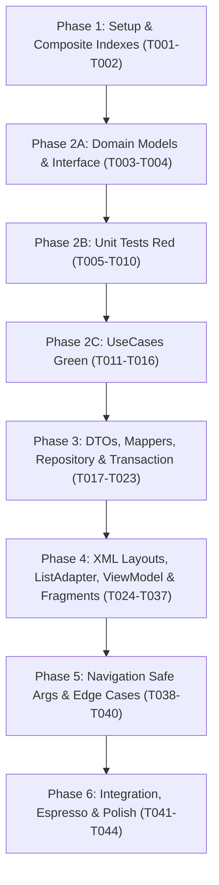

# Tasks: Quản lý lịch đặt của tôi (Spec 060)

**Input**: Tài liệu thiết kế trong `specs/060-my-bookings/`: [plan.md](plan.md), [spec.md](spec.md), [research.md](research.md), [data-model.md](data-model.md), [contracts/ui-contracts.md](contracts/ui-contracts.md), [quickstart.md](quickstart.md).

**Tests & Architecture Guidelines**:
- **Constitution I (Clean Architecture)**: Tầng `domain` hoàn toàn thuần Kotlin, tuyệt đối không import Android SDK (`android.graphics.Bitmap`, `Context`, `View`) hay Firebase SDK (`Timestamp`, `DocumentSnapshot`). Model ma trận QR `QrBitMatrix(width: Int, height: Int, bits: BooleanArray)` được sinh độc lập qua thư viện thuần ZXing Core; tầng UI chuyển đổi sang `Bitmap` qua `QrBitmapRenderer.kt` với khung viền trắng `#FFFFFF`, kích thước tối thiểu 240dp để máy quét chủ sân nhận diện tốt kể cả khi thiết bị bật Dark Mode.
- **Constitution II & III (Money & Server Validation)**: Toàn bộ số tiền (`subtotalAmount`, `discountAmount`, `paidAmount`, `depositAmount`, `refundAmount`, `penaltyAmount`) bắt buộc sử dụng kiểu `Long` (VND, cấm âm, tuyệt đối cấm Double/Float).
- **Bảo mật chống gian lận giờ điện thoại**: Khai báo trong `firestore.rules` sử dụng `request.time` (Server Timestamp của Google Cloud) đối chiếu với `resource.data.startAt` để kiểm tra mốc 240 phút khi hủy đơn, ngăn chặn triệt để hành vi người dùng chỉnh lùi đồng hồ trên thiết bị để nhận hoàn tiền 100%. Giới hạn quyền đọc chuỗi nhạy cảm `qrToken` chỉ cho chủ đơn (`request.auth.uid == resource.data.userId`).
- **Giao dịch Firestore Transaction hủy đơn & nhả slot nguyên tử (All Reads Before All Writes)**:
  + **Pha Đọc (All Reads)**: Đọc `bookings/{bookingId}` (kiểm tra `status IN [PENDING, CONFIRMED]`, `checkedInAt == null`, `userId == auth.uid`), đọc `recurringGroups/{recurringGroupId}` (nếu hủy buổi lẻ trong chuỗi cố định để xác định thứ tự buổi và phần dư làm tròn), kiểm tra tính Idempotent qua document `users/{userId}/walletTransactions/refund_{bookingId}`, đọc `users/{userId}` lấy `walletBalance`, và tính báo giá hoàn tiền.
  + **Pha Ghi/Xóa (All Writes/Deletes)**: Chuyển đơn sang `CANCELLED` (và cập nhật trạng thái nhóm `recurringGroups` nếu có), cộng `refundAmount` vào `walletBalance` (nếu > 0L), ghi log giao dịch `refund_{bookingId}`, và XÓA TOÀN BỘ các document `slots/{slotId}` thuộc đơn để giải phóng sân ngay lập tức trên lưới khung giờ của Spec 040.
- **Thuật toán Tính tiền hoàn mốc 240 phút & Kẹp biên an toàn khi có Voucher (`CalculateRefundQuoteUseCase`)**:
  + Đơn `PENDING`: Hoàn 100% tiền đã trả (`refundAmount = paidAmount`, `penaltyAmount = 0L`).
  + Đơn `CONFIRMED` hủy sớm ($\ge 240$ phút trước giờ chơi): Hoàn 100% tiền đã trả (`refundAmount = paidAmount`, `penaltyAmount = 0L`).
  + Đơn `CONFIRMED` hủy trễ ($< 240$ phút trước giờ chơi):
    * Trả qua ví giả lập (100%): Phạt 30% tiền cọc chuẩn hóa, hoàn phần còn lại. Kẹp biên an toàn chống số tiền âm khi có áp voucher: `penaltyAmount = minOf(booking.paidAmount, calculatedDepositPenalty)`, `refundAmount = maxOf(0L, booking.paidAmount - penaltyAmount)`.
    * Đặt cọc 30%: Mất 100% tiền cọc (`penaltyAmount = paidAmount`, `refundAmount = 0L`).
    * Trả tại sân (`AT_VENUE`): Hoàn 0đ, phạt 0đ (`penaltyAmount = 0L`, `refundAmount = 0L`).
- **Thỏa thuận liên thành viên**:
  + **Phương án 2.A**: Tab 2 (Chờ duyệt) đếm ngược 60 phút hạn chủ sân duyệt. Nếu quá 60 phút, hiển thị đơn `REJECTED` (quá hạn duyệt) và thông báo đã hoàn 100% tiền vào ví giả lập.
  + **Phương án 5.A**: Khóa tuyệt đối quyền viết đánh giá ở Spec 070 đối với các đơn mang trạng thái `NO_SHOW` (vắng mặt/không check-in).
  + **Chuỗi cố định [041]**: Hỗ trợ hủy riêng lẻ từng buổi trong `recurringGroupId`. Phân bổ đều tiền cọc/voucher cho từng buổi, phần lẻ do làm tròn dồn vào buổi cuối cùng của chuỗi.
- **Realtime Check-in & Hỗ trợ QR Offline**:
  + Lắng nghe realtime `bookings/{bookingId}` qua Flow; khi chủ sân quét QR thành công (`checkedInAt != null`), UI lập tức cập nhật sang "Đã check-in lúc HH:mm" và ẩn nút "Hủy lịch đặt".
  + Tận dụng Firestore Offline Persistence để người chơi có thể xuất trình mã QR check-in ngay cả khi mất kết nối mạng (4G/Wi-Fi) tại sân.
- **Chuẩn hóa Hợp đồng Điều hướng Safe Args**:
  + Nhận `ReceiptToMyBookingsArgs` từ Spec 050 mở ngay Tab "Chờ duyệt" (`PENDING`).
  + Nút "Thanh toán tiếp" từ Tab 1 (Chờ thanh toán) truyền `HoldToPaymentArgs` sang Spec 050 (kế thừa nguyên vẹn `holdExpiresAtMillis`, tuyệt đối không reset 5 phút mới).
  + Nút "Đặt lại sân này" từ Tab 4/5 điều hướng sang Spec 040 kèm `venueId`.
  + Nút "Viết đánh giá" từ Tab 4 (chỉ mở cho đơn `COMPLETED`, khóa với `NO_SHOW`) điều hướng sang Spec 070.

---

## Quy ước viết tắt đường dẫn

| Viết tắt | Đường dẫn thực tế |
|---|---|
| `APP/` | `app/src/main/java/com/example/booking_app/` |
| `CORE/` | `app/src/main/java/com/example/booking_app/core/` |
| `BOOKING_MGT/` | `app/src/main/java/com/example/booking_app/feature/booking_management/` |
| `RES/` | `app/src/main/res/` |
| `TEST/` | `app/src/test/java/com/example/booking_app/` |
| `ATEST/` | `app/src/androidTest/java/com/example/booking_app/` |

---

## Danh sách công việc theo User Stories & Phases

```
US1: Xem danh sách và chi tiết các đơn đặt sân theo 5 tab trạng thái (P1) 🎯 MVP
US2: Hiển thị mã QR check-in tại sân cho đơn đã xác nhận (P1)
US3: Hủy đơn đặt sân và hoàn tiền ví giả lập theo chính sách (P1)
US4: Quản lý và hủy riêng lẻ buổi trong chuỗi đặt cố định theo tuần (P2)
US5: Tiếp tục thanh toán đơn giữ chỗ và đặt lại nhanh từ lịch sử (P2)
```

---

## Phase 1: Setup & Test Infrastructure (Nền tảng hạ tầng)

**Mục tiêu**: Thiết lập cấu hình Composite Index trong Firestore phục vụ phân trang 5 tab và chuẩn bị test fixtures dữ liệu giả lập.

- [ ] T001 Khai báo Composite Index cho Firestore trong `firestore.indexes.json`:
  - `bookings`: `userId` (ASC), `status` (ASC), `startAt` (ASC) phục vụ Tab 1 (`HOLD`), Tab 2 (`PENDING`), Tab 3 (`CONFIRMED`).
  - `bookings`: `userId` (ASC), `status` (ASC), `startAt` (DESC) phục vụ Tab 4 (`COMPLETED`, `NO_SHOW`).
  - `bookings`: `userId` (ASC), `status` (ASC), `updatedAt` (DESC) phục vụ Tab 5 (`CANCELLED`, `REJECTED`).
  *Verify*: `firebase deploy --only firestore:indexes --dry-run` hoặc file JSON hợp lệ.
- [ ] T002 [P] Tạo bộ test fixtures `TEST/feature/booking_management/fixture/BookingManagementFixtures.kt`: Cung cấp dữ liệu mẫu cho `BookingDto`, `CancelBookingRequestDto`, mock đơn ở cả 5 trạng thái (`HOLD`, `PENDING`, `CONFIRMED`, `COMPLETED`, `CANCELLED`, `NO_SHOW`), đơn chu kỳ cố định `recurringGroupId`, và mock snapshots số dư ví.
  *Verify*: File biên dịch độc lập không lỗi cú pháp.

**Checkpoint**: Hạ tầng index và dữ liệu giả lập sẵn sàng phục vụ quy trình TDD.

---

## Phase 2: Domain Layer & Core Business Logic (Kiến trúc thuần Kotlin & TDD)

**Mục tiêu**: Xây dựng toàn bộ Domain Models, Repository Interface và 6 UseCases thuần Kotlin. Viết Unit Tests trước theo quy chuẩn Test-First (TDD Red), sau đó cài đặt UseCases (Green).

### 2A. Domain Models & Repository Interface
- [ ] T003 [P] Định nghĩa các Domain Models thuần Kotlin trong `BOOKING_MGT/domain/model/`:
  - `BookingTab.kt` (Enum: `HOLD`, `PENDING`, `UPCOMING`, `COMPLETED`, `CANCELLED`)
  - `BookingSummaryItem.kt` (`bookingId`: String, `venueName`: String, `courtNames`: List<String>, `date`: String, `timeSlot`: String, `totalAmount`: Long, `status`: String, `paymentStatus`: String, `isRecurring`: Boolean, `recurringGroupId`: String?, `holdExpiresAtMillis`: Long?, `approvalDeadlineMillis`: Long?, `startAtMillis`: Long)
  - `BookingDetail.kt` (`bookingId`: String, `userId`: String, `venueId`: String, `venueName`: String, `venueAddress`: String, `venuePhone`: String, `items`: List<BookingSlotItem>, `status`: String, `subtotal`: Long, `discount`: Long, `total`: Long, `depositAmount`: Long, `paidAmount`: Long, `remainingAmount`: Long, `paymentMethod`: String, `paymentStatus`: String, `qrToken`: String?, `checkedInAt`: Long?, `completedAt`: Long?, `cancelReason`: String?, `cancelledBy`: String?, `refundAmount`: Long?, `isRecurring`: Boolean, `recurringGroupId`: String?, `startAtMillis`: Long, `endAtMillis`: Long, `createdAt`: Long)
  - `BookingSlotItem.kt` (`slotId`: String, `courtId`: String, `courtName`: String, `date`: String, `startAt`: String, `endAt`: String, `price`: Long)
  - `RefundPolicyQuote.kt` (`bookingId`: String, `isEligibleForCancel`: Boolean, `isEarlyCancel`: Boolean, `minutesUntilStart`: Long, `paidAmount`: Long, `penaltyAmount`: Long, `refundAmount`: Long, `policyExplanation`: String)
  - `RecurringBookingGroupDetail.kt` (`recurringGroupId`: String, `venueName`: String, `totalSessions`: Int, `completedSessions`: Int, `sessions`: List<RecurringSessionSummary>)
  - `RecurringSessionSummary.kt` (`bookingId`: String, `sessionIndex`: Int, `date`: String, `timeSlot`: String, `courtName`: String, `status`: String, `allocatedPaidAmount`: Long)
  - `QrBitMatrix.kt` (`width`: Int, `height`: Int, `bits`: BooleanArray)
  *Verify*: File thuần Kotlin, tuyệt đối không import `android.*` hay `com.google.firebase.*`.
- [ ] T004 [P] Định nghĩa `BookingManagementRepository.kt` interface trong `BOOKING_MGT/domain/repository/`:
  - `getBookingsByTab(userId: String, tab: BookingTab, pageSize: Int, lastDocSnapshot: Any?): Flow<Result<List<BookingSummaryItem>>>`
  - `observeBookingDetail(bookingId: String): Flow<Result<BookingDetail>>` (realtime listener)
  - `getRecurringGroupDetail(recurringGroupId: String): Result<RecurringBookingGroupDetail>`
  - `calculateRefundQuote(booking: BookingDetail, serverCurrentTimeMillis: Long): Result<RefundPolicyQuote>`
  - `cancelBookingTransaction(userId: String, bookingId: String, reason: String, requestId: String): Result<RefundPolicyQuote>`
  - `cancelRecurringSessionTransaction(userId: String, bookingId: String, recurringGroupId: String, reason: String, requestId: String): Result<RefundPolicyQuote>`
  *Verify*: Interface độc lập thuần Kotlin, không import Android/Firebase SDK.

### 2B. Unit Tests trước cho UseCases (TDD Red)
- [ ] T005 [P] [US3] Viết Unit Test `TEST/feature/booking_management/usecase/CalculateRefundQuoteUseCaseTest.kt`:
  - Test đơn `PENDING` hủy $\rightarrow$ phạt 0đ, hoàn 100% tiền đã trả.
  - Test đơn `CONFIRMED` hủy sớm ($\ge 240$ phút) $\rightarrow$ phạt 0đ, hoàn 100% tiền đã trả.
  - Test đơn `CONFIRMED` hủy tại mốc biên đúng 240 phút $\rightarrow$ hoàn 100%.
  - Test đơn `CONFIRMED` hủy trễ ($< 240$ phút) trả bằng Ví giả lập $\rightarrow$ phạt 30% cọc chuẩn hóa, hoàn 70% ví.
  - Test đơn `CONFIRMED` hủy trễ trả bằng Đặt cọc 30% $\rightarrow$ phạt 100% cọc, hoàn 0đ.
  - Test đơn `CONFIRMED` hủy trễ trả tại sân (`AT_VENUE`) $\rightarrow$ phạt 0đ, hoàn 0đ.
  - Test kẹp biên an toàn khi có voucher: đơn gốc 200k áp voucher giảm 160k thực trả 40k $\rightarrow$ `penaltyAmount = 40k`, `refundAmount = 0đ` (chống âm tiền).
  *Verify*: Chạy `./gradlew testDebugUnitTest --tests "*.CalculateRefundQuoteUseCaseTest"` báo Red (chưa có code cài đặt).
- [ ] T006 [P] [US2] Viết Unit Test `TEST/feature/booking_management/usecase/GenerateCheckInQrUseCaseTest.kt`:
  - Test truyền `qrToken` ngẫu nhiên $\rightarrow$ sinh ra `QrBitMatrix` kích thước $512 \times 512$ pixel với dữ liệu bit boolean hợp lệ trên JVM thuần mà không cần Android SDK.
  *Verify*: Chạy `./gradlew testDebugUnitTest --tests "*.GenerateCheckInQrUseCaseTest"` báo Red.
- [ ] T007 [P] [US3] Viết Unit Test `TEST/feature/booking_management/usecase/CancelBookingUseCaseTest.kt`:
  - Test gọi hủy đơn: cập nhật đơn `CANCELLED`, cộng ví giả lập và xóa các slot tương ứng.
  - Test tính Idempotent: gọi hủy 2 lần trên cùng đơn với cùng `requestId` không cộng tiền 2 lần nhờ document `refund_{bookingId}`.
  *Verify*: Chạy `./gradlew testDebugUnitTest --tests "*.CancelBookingUseCaseTest"` báo Red.
- [ ] T008 [P] [US4] Viết Unit Test `TEST/feature/booking_management/usecase/CancelRecurringSessionUseCaseTest.kt`:
  - Test hủy 1 buổi lẻ trong chuỗi định kỳ 4 buổi (mỗi buổi phân bổ 60k cọc) $\rightarrow$ hoàn đúng 60k, 3 buổi còn lại giữ nguyên `CONFIRMED`.
  - Test phân bổ phần dư làm tròn: chuỗi 250k chia 3 buổi (83k, 83k, 84k) $\rightarrow$ tổng hoàn qua 3 lần hủy bằng chính xác 250.000đ.
  *Verify*: Chạy `./gradlew testDebugUnitTest --tests "*.CancelRecurringSessionUseCaseTest"` báo Red.
- [ ] T009 [P] [US1] Viết Unit Test `TEST/feature/booking_management/usecase/GetMyBookingsByTabUseCaseTest.kt`:
  - Test đọc danh sách theo từng Tab: lọc đúng `status`, tự động ẩn đơn `EXPIRED` ở Tab 1, sắp xếp `startAt` tăng dần ở Tab 3 và giảm dần ở Tab 4.
  *Verify*: Chạy `./gradlew testDebugUnitTest --tests "*.GetMyBookingsByTabUseCaseTest"` báo Red.
- [ ] T010 [P] [US1] [US2] Viết Unit Test `TEST/feature/booking_management/usecase/GetBookingDetailUseCaseTest.kt`:
  - Test phát dữ liệu chi tiết đơn qua Flow (gọi `repository.observeBookingDetail`) và cập nhật realtime khi trường `checkedInAt` có giá trị.
  *Verify*: Chạy `./gradlew testDebugUnitTest --tests "*.GetBookingDetailUseCaseTest"` báo Red.

### 2C. Cài đặt UseCases (TDD Green)
- [ ] T011 [P] [US3] Cài đặt `CalculateRefundQuoteUseCase.kt` trong `BOOKING_MGT/domain/usecase/`: Thực hiện logic tính khoảng cách thời gian theo giờ server, áp dụng chính sách mốc 240 phút và công thức kẹp biên an toàn chống âm tiền.
  *Verify*: `CalculateRefundQuoteUseCaseTest` chuyển sang Green (Pass).
- [ ] T012 [P] [US2] Cài đặt `GenerateCheckInQrUseCase.kt` trong `BOOKING_MGT/domain/usecase/`: Sử dụng ZXing Core `QRCodeWriter().encode` sinh ra ma trận bit `QrBitMatrix`.
  *Verify*: `GenerateCheckInQrUseCaseTest` chuyển sang Green (Pass).
- [ ] T013 [P] [US3] Cài đặt `CancelBookingUseCase.kt` trong `BOOKING_MGT/domain/usecase/`: Gọi `BookingManagementRepository.cancelBookingTransaction`.
  *Verify*: `CancelBookingUseCaseTest` chuyển sang Green (Pass).
- [ ] T014 [P] [US4] Cài đặt `CancelRecurringSessionUseCase.kt` trong `BOOKING_MGT/domain/usecase/`: Tính toán phân bổ cọc/voucher và gọi `cancelRecurringSessionTransaction`.
  *Verify*: `CancelRecurringSessionUseCaseTest` chuyển sang Green (Pass).
- [ ] T015 [P] [US1] Cài đặt `GetMyBookingsByTabUseCase.kt` trong `BOOKING_MGT/domain/usecase/`: Điều phối truy vấn danh sách đơn phân trang theo Tab.
  *Verify*: `GetMyBookingsByTabUseCaseTest` chuyển sang Green (Pass).
- [ ] T016 [P] [US1] [US2] Cài đặt `GetBookingDetailUseCase.kt` trong `BOOKING_MGT/domain/usecase/`: Kết nối Flow realtime đọc chi tiết đơn qua `repository.observeBookingDetail`.
  *Verify*: `GetBookingDetailUseCaseTest` chuyển sang Green (Pass).

**Checkpoint**: Toàn bộ 6 UseCases tầng Domain hoàn thành và vượt qua 100% Unit Tests độc lập.

---

## Phase 3: Data Layer & Infrastructure (Thực thi Repository & Transaction Hủy đơn)

**Mục tiêu**: Xây dựng DTOs, Mappers và cài đặt `BookingManagementRepositoryImpl` với Firestore Transaction hủy đơn 2 pha nguyên tử (All Reads Before All Writes), realtime snapshot listener qua `callbackFlow`, cấu hình Firestore Offline Persistence và Security Rules.

- [ ] T017 [P] Tạo các DTOs trong `BOOKING_MGT/data/model/`:
  - `BookingDto.kt` (`bookingId`, `userId`, `venueId`, `recurringGroupId`, `venueSnapshot`, `items`, `status`, `subtotal`, `discount`, `total`, `depositAmount`, `paymentMethod`, `paymentStatus`, `qrToken`, `checkedInAt`, `completedAt`, `approvalDeadline`, `cancelReason`, `cancelledBy`, `refundAmount`, `startAt`, `endAt`, `createdAt`, `updatedAt`)
  - `CancelBookingRequestDto.kt` (`bookingId`, `reason`, `requestId`, `timestamp`)
  - `RecurringGroupDto.kt` (`recurringGroupId`, `totalSessions`, `sessions`)
  *Verify*: File biên dịch không lỗi, có constructor mặc định hỗ trợ Firestore deserialization.
- [ ] T018 [P] Tạo `BookingManagementMapper.kt` trong `BOOKING_MGT/data/mapper/`: Chuyển đổi qua lại giữa `BookingDto` $\leftrightarrow$ `BookingSummaryItem` / `BookingDetail` / `RecurringBookingGroupDetail`.
  *Verify*: Viết Unit Test `BookingManagementMapperTest.kt` kiểm tra chuyển đổi không làm mất mát trường dữ liệu.
- [ ] T019 Xây dựng `BookingManagementRepositoryImpl.kt` trong `BOOKING_MGT/data/repository/` (Phần 1 - Truy vấn phân trang 5 Tab & Lắng nghe Realtime):
  - Cài đặt `getBookingsByTab`: Truy vấn theo Composite Index, phân trang `limit(10)` kèm `startAfterDocument`, lọc bỏ đơn `status == "HOLD"` đã quá hạn `holdExpiresAt <= now`.
  - Cài đặt `observeBookingDetail`: Bọc `collection("bookings").document(bookingId).addSnapshotListener` trong `callbackFlow`, tự động hủy listener khi flow đóng.
  *Verify*: Unit Test đọc danh sách và lắng nghe realtime hoạt động chính xác với mock Firestore.
- [ ] T020 Xây dựng `BookingManagementRepositoryImpl.kt` trong `BOOKING_MGT/data/repository/` (Phần 2 - Firestore Transaction Hủy đơn nguyên tử 2 pha):
  - Cài đặt `cancelBookingTransaction` tuân thủ quy tắc Firestore:
    + **Pha Đọc (All Reads)**: Đọc `bookings/{bookingId}`, kiểm tra `userId == auth.uid`, `status IN [PENDING, CONFIRMED]`, `checkedInAt == null`; đọc `users/{userId}/walletTransactions/refund_{bookingId}` (kiểm tra Idempotency); nếu `refundAmount > 0L`, đọc `users/{userId}` lấy `walletBalance`.
    + **Pha Ghi & Xóa (All Writes & Deletes)**: Cập nhật `bookings/{bookingId}` sang `CANCELLED` ghi rõ `refundAmount`, `cancelReason`, `cancelledBy = USER`; cập nhật `walletBalance` và ghi `refund_{bookingId}`; **xóa toàn bộ các document `slots/{slotId}`** thuộc đơn bằng `transaction.delete(slotRef)`.
  *Verify*: Kiểm tra logic không có bất kỳ lệnh get() nào nằm sau lệnh set()/delete().
- [ ] T021 Xây dựng `BookingManagementRepositoryImpl.kt` trong `BOOKING_MGT/data/repository/` (Phần 3 - Transaction Hủy 1 buổi lẻ trong chuỗi cố định):
  - Cài đặt `cancelRecurringSessionTransaction`: Đọc `recurringGroups/{recurringGroupId}`, xác định thứ tự buổi để phân bổ cọc/voucher (phần dư dồn buổi cuối), hủy đơn con của buổi đó và xóa slot trong cùng Transaction.
  *Verify*: Biên dịch không lỗi, tính toán hoàn tiền phân bổ chính xác.
- [ ] T022 [P] Khai báo Hilt DI Module `BookingManagementDataModule.kt` trong `BOOKING_MGT/di/`: Liên kết `@Binds` `BookingManagementRepositoryImpl` vào `BookingManagementRepository`.
  *Verify*: Build pass `./gradlew assembleDebug`.
- [ ] T023 [P] Cập nhật `firestore.rules`:
  - Sử dụng `request.time` đối chiếu với `resource.data.startAt` để kiểm tra mốc 240 phút khi hủy đơn, chặn lùi giờ thiết bị.
  - Giới hạn chỉ chủ sở hữu (`request.auth.uid == resource.data.userId`) mới được quyền đọc `qrToken` và gửi yêu cầu hủy đơn.
  *Verify*: Chạy `firebase emulators:start --only firestore` kiểm tra cú pháp rules hợp lệ.

**Checkpoint**: Tầng Data hoàn tất, Transaction hủy đơn và cơ chế lắng nghe realtime sẵn sàng.

---

## Phase 4: UI Layer & ViewModel (Giao diện Material 3 & Quản lý State)

**Mục tiêu**: Xây dựng XML layouts Material 3, ViewPager2 5 tab, đồng bộ Ticker đếm ngược tập trung trên RecyclerView tránh memory leak, render mã QR nền trắng 240dp và hộp thoại hủy đơn.

### 4A. XML Layouts & ListAdapters
- [ ] T024 [P] Thiết kế layout XML `RES/layout/fragment_my_bookings.xml`:
  - `TabLayout` hiển thị 5 tab: "Chờ thanh toán", "Chờ duyệt", "Sắp tới", "Đã hoàn thành", "Đã hủy".
  - `ViewPager2` vuốt mượt mà giữa các tab.
  *Verify*: Render chuẩn trên Android Studio Preview.
- [ ] T025 [P] Thiết kế layout XML `RES/layout/fragment_booking_tab_list.xml`:
  - `SwipeRefreshLayout` bọc `RecyclerView` hiển thị danh sách đơn.
  - Khối Empty State (hình minh họa, thông điệp thân thiện và nút "Khám phá đặt sân ngay").
  - Khối Loading Shimmer/Skeleton.
  *Verify*: Render đầy đủ các trạng thái giao diện.
- [ ] T026 [P] Thiết kế layout XML `RES/layout/item_booking_card.xml`:
  - `MaterialCardView` hiển thị thông tin thẻ đơn tóm tắt: Tên cơ sở sân, ngày chơi, khung giờ, danh sách sân con, tổng tiền.
  - Tag trạng thái màu Material 3 tương ứng (`HOLD`, `PENDING`, `CONFIRMED`, `COMPLETED`, `CANCELLED`, `NO_SHOW`).
  - Nhãn "Đặt cố định" (nếu thuộc chuỗi tuần).
  - Ticker đếm ngược thời gian (cho Tab 1 hạn giữ chỗ, Tab 2 hạn duyệt 60 phút).
  - Nút hành động theo ngữ cảnh: "Thanh toán tiếp" (Tab 1), "Đặt lại sân này" (Tab 4/5), "Viết đánh giá" (Tab 4 đơn `COMPLETED`, khóa/ẩn với `NO_SHOW`).
  *Verify*: Thẻ đơn hiển thị trực quan, phân cấp thông tin rõ ràng.
- [ ] T027 [P] Thiết kế layout XML `RES/layout/fragment_booking_detail.xml`:
  - Thông tin cơ sở: Tên, địa chỉ kèm nút mở bản đồ ngoại vi, số hotline.
  - Chi tiết các slot/buổi chơi và bảng tài chính (tiền gốc, giảm giá voucher, số tiền đã cọc/trả ví, tiền còn lại trả tại sân).
  - Khối Mã QR check-in: Nền trắng `#FFFFFF`, kích thước tối thiểu 240dp kèm mã chữ bên dưới và hướng dẫn xuất trình tại sân (chỉ hiện khi `CONFIRMED` chưa check-in).
  - Dòng trạng thái "Đã check-in lúc HH:mm" (khi `checkedInAt != null`).
  - Nút "Hủy lịch đặt" (hiển thị khi đủ điều kiện hủy).
  *Verify*: Layout render rõ nét, tương thích Dark Mode.
- [ ] T028 [P] Thiết kế layout XML `RES/layout/fragment_recurring_group_detail.xml`:
  - Thẻ tóm tắt chuỗi cố định: Tên sân, tổng số buổi, số buổi đã hoàn thành.
  - `RecyclerView` liệt kê từng buổi trong chu kỳ kèm trạng thái riêng và nút "Hủy buổi này".
  - Nút "Hủy tất cả các buổi còn lại".
  *Verify*: Layout phân cấp rành mạch, dễ thao tác.
- [ ] T029 [P] Thiết kế layout XML `RES/layout/dialog_cancel_booking_confirmation.xml`:
  - Tiêu đề và cảnh báo chính sách hoàn tiền tương ứng (hoàn 100% hoặc phạt 30% cọc).
  - `RadioGroup` danh sách lý do định sẵn (Bận việc đột xuất, Đổi thời gian, Đặt nhầm sân, Khác).
  - `TextInputLayout` nhập lý do tự do (khi chọn "Khác").
  - Nút "Xác nhận hủy" và nút "Quay lại".
  *Verify*: Dialog rõ ràng, thông tin minh bạch.
- [ ] T030 [P] Xây dựng tiện ích UI `QrBitmapRenderer.kt` trong `BOOKING_MGT/ui/util/`:
  - Chuyển đổi `QrBitMatrix` sang `android.graphics.Bitmap` với màu đen trên nền trắng `#FFFFFF`, thêm padding 16dp bảo đảm máy quét tại sân quét tốt trong Dark Mode.
  *Verify*: Unit test kiểm tra kích thước Bitmap và màu sắc pixel chuẩn.
- [ ] T031 [P] Xây dựng các Adapters trong `BOOKING_MGT/ui/adapter/`:
  - `MyBookingsPagerAdapter.kt`: Kế thừa `FragmentStateAdapter` quản lý 5 tab.
  - `BookingListAdapter.kt`: Kế thừa `ListAdapter` với `DiffUtil.ItemCallback<BookingSummaryItem>`, nhận luồng `serverNowMillis` Flow tập trung từ ViewModel để đồng bộ hiển thị đếm ngược mà không tạo timer rời rạc gây rò rỉ bộ nhớ.
  - `RecurringSessionAdapter.kt`: Hiển thị danh sách các buổi chơi trong chuỗi cố định.
  *Verify*: Adapter bind dữ liệu mượt mà, DiffUtil tính toán chính xác.

### 4B. ViewModels & Fragments
- [ ] T032 [P] Định nghĩa UiState và UiEffect trong `BOOKING_MGT/ui/`:
  - `MyBookingsUiState.kt` (danh sách đơn theo từng tab, trạng thái phân trang, loading, error).
  - `BookingDetailUiState.kt` (chi tiết đơn, `QrBitMatrix?`, quote hoàn tiền, realtime check-in status).
  - `BookingUiEffect.kt` (`ShowToast`, `NavigateToPayment(args: HoldToPaymentArgs)`, `NavigateToRebook(venueId: String)`, `NavigateToReview(bookingId: String)`, `ShowCancelSuccessDialog(refundAmount: Long)`).
  *Verify*: Sealed classes/data classes thuần Kotlin.
- [ ] T033 Xây dựng `MyBookingsViewModel.kt` trong `BOOKING_MGT/ui/`:
  - Quản lý tải dữ liệu phân trang 10 đơn cho từng Tab qua `GetMyBookingsByTabUseCase`.
  - Phát `serverNowMillis` StateFlow mỗi giây một lần để đồng bộ đếm ngược trên `BookingListAdapter`.
  - Tự động chuyển đến tab tương ứng khi nhận đối số Safe Args `ReceiptToMyBookingsArgs.initialTab`.
  *Verify*: Viết Unit Test kiểm thử ticker Flow và luồng chuyển Tab.
- [ ] T034 Xây dựng `BookingDetailViewModel.kt` trong `BOOKING_MGT/ui/`:
  - Lắng nghe realtime `GetBookingDetailUseCase`, khi `checkedInAt != null` thì cập nhật trạng thái đã check-in.
  - Tự động gọi `GenerateCheckInQrUseCase` khi đơn ở trạng thái `CONFIRMED`.
  - Gọi `CalculateRefundQuoteUseCase` khi người chơi mở hộp thoại hủy đơn.
  - Gọi `CancelBookingUseCase` thực thi hủy đơn và phát `UiEffect` thành công.
  *Verify*: Viết Unit Test bao phủ toàn bộ các luồng trạng thái của ViewModel.
- [ ] T035 Cài đặt `MyBookingsFragment.kt` và `BookingTabListFragment.kt` trong `BOOKING_MGT/ui/`:
  - Kết nối `TabLayout` và `ViewPager2`, cấu hình `SwipeRefreshLayout` và sự kiện cuộn phân trang.
  - Thu thập StateFlow qua `repeatOnLifecycle(Lifecycle.State.STARTED)`.
  - Xử lý click thẻ đơn và các nút hành động ("Thanh toán tiếp", "Đặt lại sân", "Viết đánh giá").
  *Verify*: Fragment hiển thị đúng 5 tab và tải dữ liệu mượt mà.
- [ ] T036 Cài đặt `BookingDetailFragment.kt` và `CancelBookingConfirmationDialog.kt` trong `BOOKING_MGT/ui/`:
  - Hiển thị đầy đủ thông tin đơn, render QR code qua `QrBitmapRenderer`.
  - Mở Dialog xác nhận hủy, bắt buộc chọn lý do mới mở khóa nút xác nhận.
  *Verify*: Dialog hủy đơn hiển thị đúng số tiền hoàn/phạt, đóng mở mượt mà.
- [ ] T037 Cài đặt `RecurringGroupDetailFragment.kt` trong `BOOKING_MGT/ui/`:
  - Hiển thị danh sách các buổi trong chuỗi cố định và xử lý hủy buổi lẻ qua `CancelRecurringSessionUseCase`.
  *Verify*: Render danh sách các buổi và cập nhật trạng thái buổi hủy ngay lập tức.

**Checkpoint**: Toàn bộ giao diện 5 tab, chi tiết đơn, hiển thị QR và hộp thoại hủy đơn hoàn tất.

---

## Phase 5: Navigation, Integration & Edge Cases (Điều hướng & Xử lý biên)

**Mục tiêu**: Tích hợp Safe Args liên module, hỗ trợ xem QR Offline khi mất kết nối mạng và cơ chế Idempotency chống double-cancel.

- [ ] T038 [P] Cấu hình Navigation Component trong `RES/navigation/nav_graph.xml`:
  - Nhận `ReceiptToMyBookingsArgs` từ Spec 050 mở ngay Tab "Chờ duyệt" (`PENDING`).
  - Nút "Thanh toán tiếp" điều hướng sang Spec 050 với `HoldToPaymentArgs` (kế thừa `holdExpiresAtMillis`).
  - Nút "Đặt lại sân này" điều hướng sang Spec 040 kèm `venueId`.
  - Nút "Viết đánh giá" điều hướng sang Spec 070 (ẩn/khóa với đơn `NO_SHOW`).
  *Verify*: Build pass `./gradlew assembleDebug` sinh ra Directions và Args classes chuẩn xác.
- [ ] T039 Hỗ trợ xem mã QR Offline khi mất mạng:
  - Cấu hình Firestore Offline Persistence: đảm bảo chi tiết đơn và `qrToken` của đơn `CONFIRMED` đã mở trước đó được lưu trong cache cục bộ.
  - Hiển thị banner nhỏ thông báo ngoại tuyến: *"Đang ở chế độ ngoại tuyến - Mã QR vẫn có hiệu lực check-in tại sân"* khi thiết bị ngắt kết nối mạng.
  *Verify*: Bật chế độ máy bay, mở lại đơn `CONFIRMED` $\rightarrow$ mã QR vẫn hiển thị rõ ràng.
- [ ] T040 Xử lý Idempotency và chặn double-cancel trên UI:
  - Vô hiệu hóa nút "Xác nhận hủy" ngay khi click đầu tiên (`isEnabled = false`, hiển thị ProgressBar xoay).
  - Tái sử dụng `requestId` UUID khi người dùng bấm thử lại do timeout mạng, bảo đảm không cộng tiền ví 2 lần.
  *Verify*: Click spam nút hủy không gây ra 2 request đồng thời.

**Checkpoint**: Luồng điều hướng liên module và các trường hợp biên ngoại tuyến/mất mạng khép kín hoàn toàn.

---

## Phase 6: System Verification & Polish (Kiểm thử hệ thống & Hoàn thiện)

**Mục tiêu**: Kiểm thử tích hợp Transaction hủy đơn trên Firebase Emulator, UI Test Espresso và đối soát checklist 29 FRs & 7 SCs.

- [ ] T041 [P] Viết Unit Test hoàn chỉnh `TEST/feature/booking_management/ui/MyBookingsViewModelTest.kt` và `BookingDetailViewModelTest.kt`: Kiểm thử quản lý 5 tab, đếm ngược ticker tập trung, sinh QR và tính toán quote hoàn tiền với Turbine.
  *Verify*: `./gradlew testDebugUnitTest --tests "*.MyBookingsViewModelTest"` pass 100%.
- [ ] T042 Viết Integration Test `ATEST/feature/booking_management/BookingCancellationEmulatorTest.kt` trên Firebase Emulator:
  - Kiểm thử 2 thiết bị cùng bấm hủy 1 đơn tại cùng thời điểm $\rightarrow$ chỉ 1 request thành công, ví chỉ nhận hoàn 1 lần duy nhất qua `refund_{bookingId}`.
  - Kiểm thử xóa sạch các document `slots/{slotId}` của đơn hủy và hiển thị ngay trên lưới Spec 040.
  - Kiểm thử Security Rules chặn chỉnh lùi giờ thiết bị bằng `request.time` đối chiếu `startAt`.
  *Verify*: Chạy pass trên Firebase Emulator (`firebase emulators:exec "./gradlew connectedDebugAndroidTest"`).
- [ ] T043 Viết UI Test Espresso `ATEST/feature/booking_management/MyBookingsFragmentTest.kt`:
  - Kiểm thử chuyển đổi qua lại giữa 5 tab.
  - Kiểm thử mở chi tiết đơn `CONFIRMED` và hiển thị mã QR.
  - Kiểm thử hiển thị Dialog xác nhận hủy đơn và kiểm tra khóa nút đánh giá cho đơn `NO_SHOW`.
  *Verify*: Chạy pass trên máy ảo Android hoặc thiết bị thật.
- [ ] T044 Rà soát và đối soát chất lượng:
  - Kiểm tra toàn bộ 29 Functional Requirements (FR-001 đến FR-029) và 7 Success Criteria (SC-001 đến SC-007) trong `specs/060-my-bookings/spec.md`.
  - Đảm bảo tuân thủ nghiêm ngặt Constitution I, II, III, V, VI.
  *Verify*: Checklist nghiệm thu đạt 100% tiêu chí.

---

## Dependencies & Execution Order



---

## Parallel Execution Opportunities

- **Trong Phase 1**: `T002` (Fixtures) có thể làm song song với `T001` (Composite Index).
- **Trong Phase 2**: `T003` và `T004` chạy song song; các file test `T005` đến `T010` có thể viết song song độc lập.
- **Trong Phase 3**: `T017` (DTOs), `T018` (Mapper), `T022` (Hilt Module), `T023` (Rules) có thể làm song song trước khi ráp vào `BookingManagementRepositoryImpl`.
- **Trong Phase 4**: `T024` đến `T030` (XML Layouts, tiện ích QR Renderer) có thể thiết kế song song độc lập trước khi ráp vào ViewModel/Fragment.
- **Trong Phase 6**: `T041` (ViewModel Test) có thể chạy song song với `T043` (UI Test Espresso).
